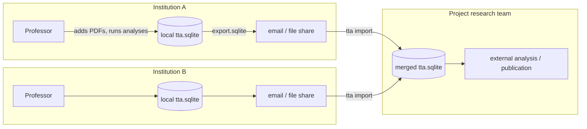
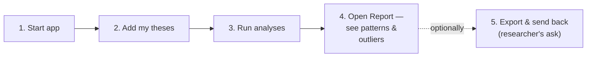
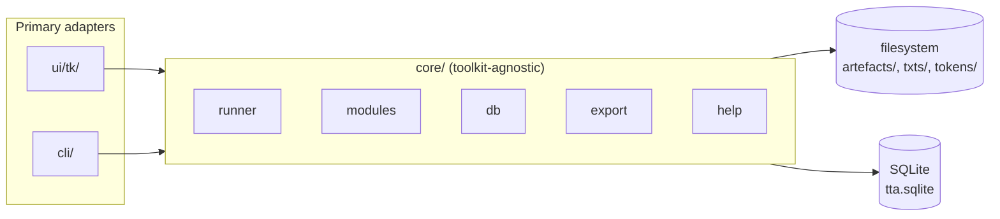
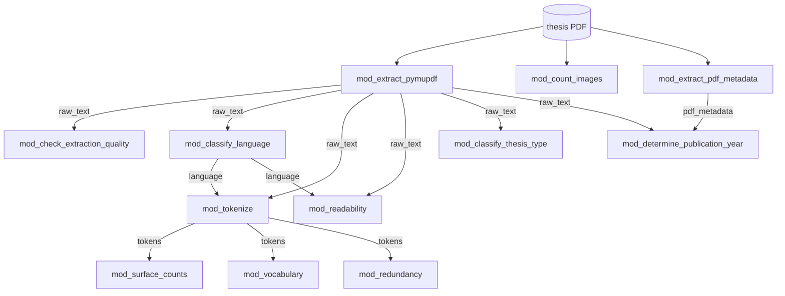
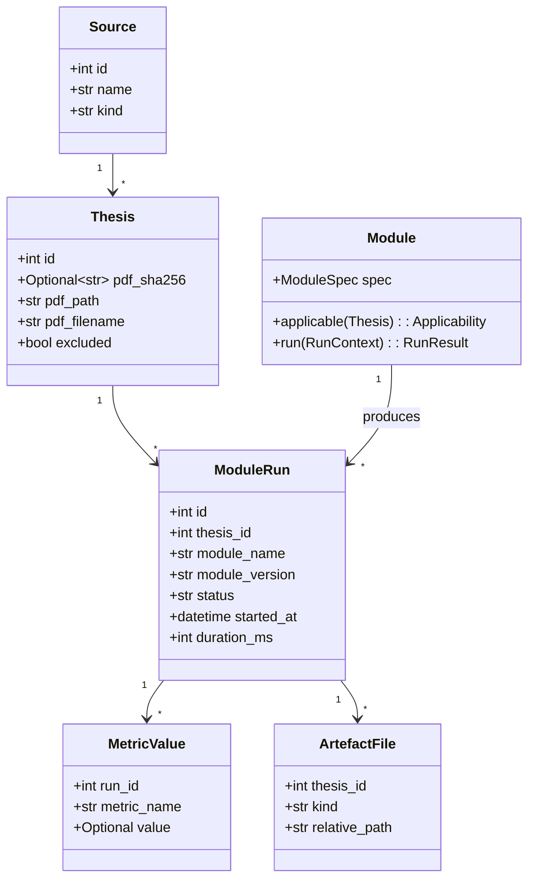
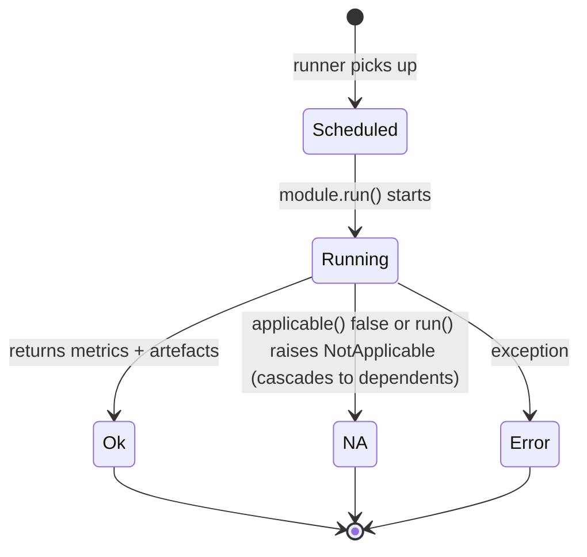
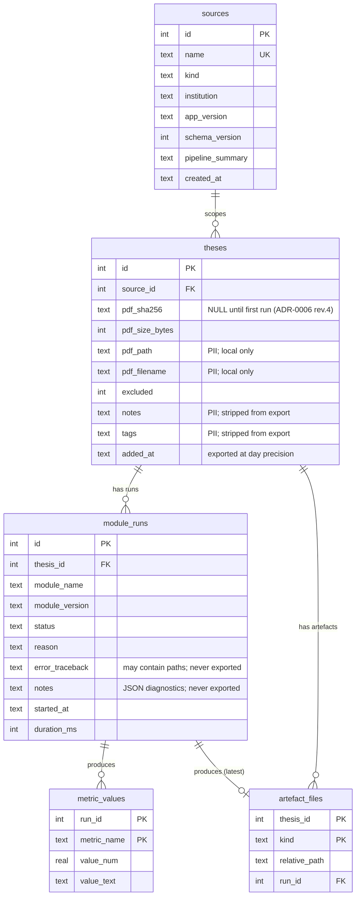

# 1. Introduction

## 1.1 Purpose

This document specifies the design of the **Thesis Text Analyzer**, a portable desktop application that computes per-thesis text metrics and tracks their evolution over publication date. The SDD is part of the project's end deliverable. Every design decision in this document is traceable to a user story ([§4](#4-user-stories)) or a quality attribute ([§10](#10-quality-attributes)); the rationale for each major decision lives in a numbered ADR under [`adr/`](adr/).

## 1.2 Scope

The MVP comprises:

- A core analysis library (`tta.core`) that runs analyses, persists results, and exports them — toolkit- and UI-agnostic.
- A graphical UI (`tta.ui.tk`) targeted at professors who provide thesis files.
- A command-line interface (`tta.cli`) targeted at researchers and developers, equal in capability to the GUI.

Out of MVP scope but architecturally accommodated: LM-based modules (perplexity, embedding burstiness), citation/quotation validity modules, smarter figure analysis, full i18n, plugin loaders. See [§12](#12-out-of-mvp-scope).

## 1.3 Definitions

| Term | Meaning |
|---|---|
| **Thesis** | A bachelor or master thesis, provided as a PDF file. |
| **Module** | An analysis unit that consumes artefacts and produces metrics and/or artefacts. Conforms to the `Module` ABC ([§6.2](#62-module-contract)). |
| **Metric** | A single scalar value (numeric or short text) computed for a thesis. |
| **Derived metric** | A metric computed from other metrics (e.g. Flesch reading ease from word, sentence, and syllable counts). |
| **Artefact** | An intermediate file produced by a module (e.g. extracted plain text). |
| **Artefact kind** | A documented identifier for the on-disk shape of an artefact (e.g. `raw_text`, `tokens`). Vocabulary in [`core/artefact_kinds.py`](#64-artefact-kinds-vocabulary). |
| **Run** | One execution of a module on a thesis; recorded in `module_runs`. |
| **Producer** | A module that produces a given artefact kind. Multiple producers per kind are allowed; the active one is selected by configuration ([ADR-005](adr/0005-producer-swap-deferred.md)). |
| **Source** | The provider of data in the database — either `local` (the user's own analyses) or `imported` (a researcher's import of a professor's export). |
| **Pipeline** | The directed acyclic graph of modules executed for one thesis. |

## 1.4 References

External (academic): Flesch (1948), Yule (1944), Amstad (1978), and others — see [`references.bib`](references.bib).

Internal: ADR documents under [`adr/`](adr/); user-story catalogue at [`user-stories.md`](user-stories.md); privacy registry at [`tta/core/privacy_metadata.py`](../tta/core/privacy_metadata.py); artefact kinds vocabulary at [`tta/core/artefact_kinds.py`](../tta/core/artefact_kinds.py).

---

# 2. System Overview

## 2.1 Research goals

In priority order:

1. **Primary** — Trace how thesis length has evolved across publication dates. The publication date is the **`publication_year` metric** — a best estimate fused by `mod_determine_publication_year` (#17) from the in-text title-page year and the PDF-metadata dates — **not** the raw PDF `creation_year`, which re-saves and repository processing make unreliable. `publication_year` is the x-axis of the report's length-over-time chart (§9.8).
2. **Secondary** — Trace and correlate other text metrics (vocabulary richness, readability, redundancy, structural features) against publication date and against each other, in support of the primary question.
3. **Tertiary** — Whether the public availability of generative AI tools (Nov 2022) coincides with any acceleration of the above trends.

### 2.1.1 Methodological output: library comparison study

The project produces a comparative evaluation of PDF text-extraction libraries (PyMuPDF, pdfminer.six, pypdf, pdfplumber, poppler `pdftotext`, …) on a thesis corpus, scoring them on:

- Extraction quality (presence of garbled output, faithfulness to layout, handling of footnotes, captions, equations).
- Resulting metric stability — do the same theses produce similar metric values across extractors?
- Resource footprint (time, memory).
- License compatibility with redistribution (informative only since [ADR-0017](adr/0017-license.md) adopts a copyleft licence — no longer a ship-blocking criterion).

Findings inform which extractor ships in the distributed `.exe` — selected on extraction quality, with the licence constraint removed by [ADR-0017](adr/0017-license.md) — and form a section of the planned publication. The architecture supports this study natively: alternative extractors are added as additional modules producing the same `raw_text` artefact kind, selected via `tta.toml` per run.

## 2.2 Distribution model

The application is sent to professors at multiple institutions. They run analyses on local thesis collections; results are written to a local SQLite database; an export is sent back to the research team. The research team imports each export as a distinct *source*, merging across institutions for cross-cohort analysis (see [ADR-006](adr/0006-schema.md), [ADR-007](adr/0007-export-format.md)).

## 2.3 Explicitly NOT goals

- **Per-thesis classification of "AI-influenced" vs "organic" authorship.** The exploration phase (see memory: `project_eth_text_analysis_findings`) showed that surface text metrics alone cannot make that distinction on academic prose, and the MVP will not claim to do so. AI detection is a possible application of the measurement substrate, not its purpose.
- **Network operation.** The application is fully offline. No telemetry, no remote update, no online dictionary lookup ([QA-PRIV](#qa-priv-privacy-local-only-no-pii-export)).
- **Plugin / runtime loading of third-party modules.** Modules are contributed via PR; new external researchers extending the catalogue follow the standard module contract. See [ADR-004](adr/0004-module-contract.md) and [§12](#12-out-of-mvp-scope).

---

# 3. Stakeholders and Operating Model

## 3.1 Personas

| Persona | Description | Default mode |
|---|---|---|
| **Professor** (primary) | Faculty at participating institutions. May be from non-technical departments; not necessarily technically versed. Owns thesis files. Uses the GUI. | Basic |
| **Power user** | Technically versed professors; researchers from the project team working on a specific cohort. Wants visibility into raw values and module configuration. | Extended (toggle in settings) |
| **Researcher** (project team) | Members of the project team; consumes exports from multiple sources; may also analyse their own theses. Uses CLI as primary interface; GUI as viewer. | Extended; CLI-first |

## 3.2 Operating model



The application binary is the same on every node; what differs is which sources exist in each local database (see [ADR-006](adr/0006-schema.md)).

## 3.3 The two happy paths

The application serves two stakeholders with overlapping but distinct goals. Acknowledging the difference avoids designing for one and accidentally compromising the other.

### 3.3.1 The researcher's contribute-data loop (US-RES-LOW-FRICTION)

What the researcher needs the professor to be able to do, in five low-friction steps:

```mermaid
flowchart LR
    S1[1. Start app] -->|"auto-opens last project"| S2[2. Select theses]
    S2 -->|"no dialog: add is instant, type is detected"| S3[3. Run all]
    S3 -->|"toolbar button, progress bar"| S4[4. Export]
    S4 -->|"save dialog, no extra choices"| S5[5. Send back]
    S5 -.->|"outside the app"| END[email / shared drive]
```



This is what motivates the **low-friction** design choices: auto-open the last project, sensible defaults, basic-mode toolbar with four core buttons, no extra checkboxes in the export dialog. Adding files is **instant and dialog-free** — the SHA-256 hash is deferred to first-run time ([ADR-0006](adr/0006-schema.md) rev. 4, #38) and the thesis type is **detected**, not entered ([ADR-0019](adr/0019-thesis-type-by-detection.md), #9). Every design choice gets reviewed against this: *does this add a step to the contribute loop?*

### 3.3.2 The professor's insights journey (US-PROF-INSIGHTS)

What actually motivates a professor to use the app voluntarily:



The professor's *reward* is in step 4 — the Report view ([§9.9](#99-report-view)) shows trends, comparisons, and outliers in their collection that they couldn't see by reading individually. Step 5 (export/send) is the researcher's interest; without step 4 there's no reason for the professor to engage.

The two journeys share the first three steps; they diverge at step 4. The researcher's "Export and send" is shifted to step 5 of the professor's path, framed as an optional thank-you rather than the goal.

---

# 4. User Stories

The full catalogue lives at [`user-stories.md`](user-stories.md). Each story has a stable identifier of the form `US-<persona>-<short>`. Identifiers are cited throughout the SDD and the ADRs.

Headline stories driving load-bearing decisions:

| ID | Story (abbreviated) | Drives |
|---|---|---|
| **US-PROF-INSIGHTS** | See interesting patterns / trends / outliers in my collection | Report view ([ADR-016](adr/0016-report-view.md)) |
| US-PROF-TRENDS | See how text characteristics evolved over years | Report → length-over-time chart |
| US-PROF-COMPARE | Compare bachelor vs master theses side-by-side | Report → length-by-type box plots |
| US-PROF-NOTICE | Have unusual theses surfaced | Report → outlier list |
| US-PROF-ATTRS | Group by thesis type (bachelor/master) | `mod_classify_thesis_type` (detected, [ADR-0019](adr/0019-thesis-type-by-detection.md)); correction via editable metrics (#10) |
| US-PROF-EXCLUDE | Exclude confidential theses | Schema, runner |
| US-PROF-EXPLAIN | Read explanations of metrics | Help system ([ADR-012](adr/0012-help-content.md)) |
| US-PROF-EXPORT | Export results into a single file | Export format ([ADR-007](adr/0007-export-format.md)) |
| US-PROF-QUALITY | See garbled extractions flagged in the grid | `mod_check_extraction_quality` |
| US-PROF-AUTO-OPEN | App remembers last project across runs | Distribution / project model ([ADR-014](adr/0014-distribution.md)) |
| **US-PROF-NO-TRACES** | No writes outside the project folder by default | Distribution / project model ([ADR-014](adr/0014-distribution.md)) |
| US-PWR-EXTENDED | Extended mode with more settings | UI modes |
| **US-RES-LOW-FRICTION** | Contribute-loop fits in five low-friction steps | Distribution, export, defaults throughout the UI |
| US-RES-CLI | Run analyses from the CLI; use GUI only as viewer | CLI as first-class ([ADR-003](adr/0003-cli-first-class.md)) |
| US-RES-IMPORT | Import multiple exports; analyse grouped by source | Schema (`source_id`) |
| US-RES-LOCAL-RERUN | Run on own theses; imported data stays read-only | Runner filter on `source.kind='local'` |
| US-RES-OUTLIERS | Quickly identify outliers in the grid | UI highlighting |
| US-RES-LANG | Know what language a thesis is in | `mod_classify_language` |

---

# 5. Architectural Design

## 5.1 Hexagonal layering



[ADR-002](adr/0002-ui-core-boundary.md) makes this binding: `core/*` must not import from `ui/*` or `cli/*`. The boundary is CI-enforced. The CLI ships with MVP as a peer of the GUI ([ADR-003](adr/0003-cli-first-class.md)).

## 5.2 Package layout

```
tta/                              # repository root
├── tta/                          # Python package (import root: `tta.*`)
│   ├── core/
│   │   ├── types.py              # Thesis + shared plain types (module contract lives in modules/base.py)
│   │   ├── events.py             # in-process pub/sub for progress
│   │   ├── db/                   # schema, migrations, repository
│   │   ├── modules/              # analysis modules — see §7
│   │   │   └── base.py           # Module ABC + ModuleSpec, RunContext, RunResult, Applicability
│   │   ├── artefact_kinds.py     # vocabulary of artefact kinds
│   │   ├── privacy_metadata.py   # source-of-truth for the GDPR statement
│   │   ├── runner.py             # dependency resolution + execution
│   │   ├── artefacts.py          # filesystem layer for cached files
│   │   ├── export.py             # anonymisation + export
│   │   ├── importer.py           # import researcher merge DB
│   │   ├── config.py             # tta.toml reader/writer
│   │   └── help/                 # markdown content (see §9.4)
│   ├── ui/
│   │   └── tk/                   # Tk + tksheet UI ([ADR-001](adr/0001-ui-toolkit.md))
│   └── cli/                      # `tta` command-line ([ADR-003](adr/0003-cli-first-class.md))
├── tests/
│   ├── fixtures/                 # tiny sample PDFs
│   ├── core/                     # tested without any UI
│   ├── modules/                  # per-module unit tests (QA-TEST)
│   └── integration/              # exercises the CLI
├── docs/                         # this SDD, ADRs, user stories
└── pyproject.toml
```

CI invariants:

```
grep -rn "tta\.ui\|from \.\. import ui\|from \.\.ui" tta/core/ tta/cli/    → no results
grep -rn "tta\.cli\|from \.\. import cli\|from \.\.cli" tta/core/ tta/ui/  → no results
```

(The former AGPL release-gate invariant — no `import fitz`/`import pymupdf` under `tta/core/` — is **retired by [ADR-0017](adr/0017-license.md)**: PyMuPDF ships under the project's copyleft licence. Only the two boundary invariants above remain.)

## 5.3 Module pipeline (DAG)



Three "root" modules read the PDF directly; everything else flows downstream from `mod_extract_pymupdf` and `mod_classify_language`. `mod_classify_thesis_type` (#9) sits off `raw_text` next to `mod_check_extraction_quality`; `mod_determine_publication_year` (#17) fuses two upstreams — `raw_text` (in-text title-page year) and the `pdf_metadata` artefact (PDF `creation_year`/`modification_year`). Detailed module specs in [§7](#7-module-catalogue).

## 5.4 Persistence

- **Database** — one SQLite file (`tta.sqlite`) at the project root. Schema in [§8.1](#81-database-schema). Append-only history on `module_runs` and `metric_values`.
- **Artefact filesystem** — `<project>/artefacts/<thesis_id>/<run_id>/<kind>.<ext>` ([ADR-006](adr/0006-schema.md)). Files referenced by relative path in `artefact_files`.
- **Configuration** — `<project>/tta.toml`. Worker count, user preferences. (Producer selection is omitted in MVP — see ADR-005.)

## 5.5 Runner orchestration

Decision: [ADR-013](adr/0013-runner-orchestration.md). The runner splits into a deterministic **plan** phase (returns a `RunPlan` data structure; side-effect-free) and a stateful **execute** phase (events + DB writes).

- One worker process per concurrent thesis (`ProcessPoolExecutor`); modules within a thesis run serially in topological order.
- Workers compute results in isolation; the main process is the sole DB writer (commit per thesis, single transaction).
- Cancellation = skip-pending; in-flight theses complete (worst case ~30–120 s lag per worker).
- Per-module timeout (default 300 s) kills stuck workers.
- Failures cascade as `na` to dependents.
- Default workers: `max(1, os.cpu_count() - 1)`.
- Events: `RunStarted`, `ThesisStarted`, `ModuleStarted`, `ModuleCompleted`, `ThesisCompleted`, `RunCompleted`, `RunCancelled`. Adapters subscribe; main process publishes (workers do not).
- **Progress + size-weighted ETA (#39).** From the event stream an adapter drives a determinate progress bar (advance per `(thesis × module)` pair) and a remaining-time estimate. The estimate is computed by a pure, toolkit-free function in `core/progress.py` (`estimate`), reusable by GUI and CLI and unit-tested without a display. It models each module's cost as a **rate** = mean(`duration_ms` / `pdf_size_bytes`) over that module's past **successful (`ok`)** runs (`Repository.module_duration_stats`), and estimates remaining time as the **sum over the remaining `(thesis × module)` pairs of** `rate[module] × that thesis's pdf_size_bytes`. This accounts for the **size** of the theses still to process, not just their count. With no history for a module, the rate observed so far **in the current run** is used; before any pair completes, the bar advances with no ETA number ("estimating..."). The GUI renders this inline in the run area beside the Cancel control ([§9.2](#92-main-window-layout)); the CLI's progress goes to stderr.

Two run modes for MVP:

- **Default** ("Run all"): missing + stale + previously-errored `(thesis × module)` pairs.
- **`--rerun`**: everything regardless of state.

A `--dry-run` flag prints the plan without executing.

## 5.6 Distribution

Decision: [ADR-014](adr/0014-distribution.md). Per-OS single-file PyInstaller `--onefile` binaries built on CI. Stateless binary + project directory. No auto-update.

On first launch the app creates `~/TTA-Theses/` (or platform equivalent) as the default project and shows a dismissible banner. Subsequent launches auto-open the last project (US-PROF-AUTO-OPEN). By default the app writes **nothing** outside the project folder (US-PROF-NO-TRACES, [ADR-014](adr/0014-distribution.md)); the last-project pointer lives inside the default project, so deleting the folder removes every trace and no `~/.config/tta` file is created. (The AGPL release-gate that previously forbade `import fitz`/`import pymupdf` under `tta/core/` is retired by [ADR-0017](adr/0017-license.md): the project adopts a copyleft licence, so PyMuPDF ships as-is.)

---

# 6. Domain Model

## 6.1 Core entities



## 6.2 Module contract

Defined in `core.modules.base`:

```python
@dataclass(frozen=True)
class ModuleSpec:
    name: str
    version: str
    consumes: tuple[str, ...] = ()             # artefact kinds
    produces_artefacts: tuple[str, ...] = ()   # artefact kinds
    produces_metrics: tuple[str, ...] = ()     # metric names

@dataclass
class RunContext:
    thesis: Thesis
    artefacts: dict[str, Path]                  # consumed artefacts by kind
    workdir: Path                               # where to write produced artefacts

@dataclass
class RunResult:
    metrics: dict[str, Any] = field(default_factory=dict)
    artefacts: dict[str, Path] = field(default_factory=dict)
    notes: dict[str, Any] = field(default_factory=dict)

@dataclass
class Applicability:
    ok: bool
    reason: str | None = None

class NotApplicable(Exception):
    """Raised from run() when applicability depends on consumed artefact
    content (e.g. the detected language); recorded as `na` with the
    exception message as reason."""

class Module(ABC):
    spec: ModuleSpec
    def applicable(self, thesis: Thesis) -> Applicability: ...
    @abstractmethod
    def run(self, ctx: RunContext) -> RunResult: ...
```

`applicable()` covers checks that need only the `Thesis` row (e.g. file extension); data-dependent checks from the applicability matrix ([§7.2](#72-applicability-matrix)) — detected language, minimum text length — happen inside `run()` via `NotApplicable`, since consumed artefact content is not available before execution.

`RunResult.notes` is free-form diagnostic context that is neither a metric nor an artefact (e.g. the stop-word ratio behind an `extraction_quality` verdict). It is persisted as JSON in `module_runs.notes` for local inspection, but — because it may contain content-derived values — it is always stripped from exports ([§8.3.1](#831-anonymisation-rules)).

Decisions: [ADR-004](adr/0004-module-contract.md) for the contract, [ADR-005](adr/0005-producer-swap-deferred.md) for producer-swap semantics.

## 6.3 Run lifecycle



`NA` cascades: a thesis whose `mod_classify_language` reports a language not in `{en, de}` will produce `NA` outcomes for `mod_readability` and `mod_tokenize`, which in turn cascades to all `tokens`-consuming modules. The grid shows distinct visual states for `ok`, `NA`, and `error`.

## 6.4 Artefact kinds vocabulary

Four kinds in MVP. The vocabulary file (`core/artefact_kinds.py`) is the documented source of truth; module declarations are checked against it at registration.

| Kind | Format | Producer (MVP) | Privacy class |
|---|---|---|---|
| `raw_text` | UTF-8 plain text file | `mod_extract_pymupdf` | Content (PII risk; never exported) |
| `language` | JSON: `{"code": "en", "confidence": 0.99}` | `mod_classify_language` | Metric (no PII) |
| `tokens` | JSON: `{"sentences": [["w","w"],…], "language": "en"}` | `mod_tokenize` | Content (PII in aggregate; never exported) |
| `pdf_metadata` | JSON: full PDF Info dict + XMP | `mod_extract_pdf_metadata` | Identifying (may include author/title; never exported) |

Artefact files are stored under the filesystem layout in [§5.4](#54-persistence) and never travel in exports ([ADR-007](adr/0007-export-format.md)).

---

# 7. Module Catalogue

Twelve modules, twenty-nine metrics. See [ADR-011](adr/0011-mvp-module-catalogue.md) for the catalogue decision; each module also has a help page at `core/help/modules/<name>.md`.

## 7.1 Overview

| # | Module | Inputs (artefacts) | Produces (artefacts) | Produces (metrics) | Notes |
|---|---|---|---|---|---|
| 1 | `mod_extract_pymupdf` | — (PDF directly) | `raw_text` | `text_chars`, `n_pages` | PyMuPDF (AGPL); ships under the project copyleft licence (ADR-0017) |
| 2 | `mod_check_extraction_quality` | `raw_text` | — | `extraction_quality` (text: `ok`/`garbled`/`sparse`) | heuristic from `harvester/GARBLED_EXTRACTIONS.md` |
| 3 | `mod_classify_language` | `raw_text` | `language` | `language_code`, `language_confidence` | langdetect |
| 4 | `mod_tokenize` | `raw_text`, `language` | `tokens` | — | NLTK punkt_tab |
| 5 | `mod_surface_counts` | `tokens` | — | `word_count`, `char_count_alpha`, `sentence_count`, `avg_word_len`, `avg_sentence_len`, `std_sentence_len` | stdlib |
| 6 | `mod_vocabulary` | `tokens` | — | `ttr`, `root_ttr`, `hapax_token_ratio`, `hapax_type_ratio`, `yules_k` | stdlib; both hapax variants (V1/N and V1/V) ship for comparison |
| 7 | `mod_readability` | `raw_text`, `language` | — | `flesch_reading_ease` | textstat (Flesch en / Amstad de) |
| 8 | `mod_redundancy` | `tokens` | — | `bigram_repetition_rate`, `trigram_repetition_rate` | stdlib |
| 9 | `mod_count_images` | — (PDF directly) | — | `n_images` | pypdf |
| 10 | `mod_extract_pdf_metadata` | — (PDF directly) | `pdf_metadata` | `page_count_meta`, `producer_category`, `creator_category`, `creation_year`, `modification_year`, `has_outline` | pypdf |
| 11 | `mod_classify_thesis_type` | `raw_text` | — | `thesis_type` (text: `bachelor`/`master`/`unspecified`) | title-page keyword heuristic (#9, ADR-0019); evidence in `notes` |
| 12 | `mod_determine_publication_year` | `raw_text`, `pdf_metadata` | — | `publication_year` (num), `publication_year_source` (text) | fuses in-text title-page year (primary) with PDF `creation_year`/`modification_year` (#17); winning source in the metric, detail in `notes` |

The third-party libraries named in the *Notes* column are inventoried — name, purpose, version,
licence — in [`dependencies.md`](dependencies.md), which doubles as the one-time
GPL-3.0-or-later compatibility audit [ADR-0017](adr/0017-license.md) calls for (#37). What those
libraries and formulas get *wrong*, and which metrics must therefore be read with caution, is
documented in [`model-limitations.md`](model-limitations.md) (#43). The MVP uses **no LLM**; the
only trained/statistical components are NLTK punkt, langdetect, and the Flesch/Amstad syllable
heuristics.

## 7.2 Applicability matrix

| Module | Applicable when | N/A reason if not |
|---|---|---|
| `mod_extract_pymupdf` | file extension is `.pdf` | not a PDF |
| `mod_check_extraction_quality` | `raw_text` exists | upstream extraction failed |
| `mod_classify_language` | `raw_text` exists and has ≥ 200 chars | text too short for confident detection |
| `mod_tokenize` | `language.code` ∈ {`en`, `de`} | unsupported language |
| `mod_surface_counts` / `mod_vocabulary` / `mod_redundancy` | `tokens` exists | upstream NA cascade |
| `mod_readability` | `language.code` ∈ {`en`, `de`} | no Flesch formula for language |
| `mod_count_images` | file is a PDF | not a PDF |
| `mod_extract_pdf_metadata` | file is a PDF | not a PDF |
| `mod_classify_thesis_type` | `raw_text` exists | upstream extraction failed (garbled/sparse text still yields `unspecified`, never `na`) |
| `mod_determine_publication_year` | `raw_text` and `pdf_metadata` exist | upstream NA cascade (no title-page year and no PDF date still yields an `ok` run with `publication_year` NULL and `publication_year_source='none'`) |

## 7.3 Library comparison study placement

Alternative producers for `raw_text` (`mod_extract_pdfminer`, `mod_extract_pypdf`, `mod_extract_pdfplumber`, `mod_extract_poppler`) are added during the project for the comparison study described in [§2.1.1](#211-methodological-output-library-comparison-study). They share the artefact kind but live in separate module files. **In MVP, exactly one producer per kind is registered**; comparing different libraries is done by swapping registrations and re-running into a separate database (per ADR-005). Runtime selection via config or CLI is deferred ([§12](#12-out-of-mvp-scope)).

## 7.4 Notes on specific modules

**`mod_extract_pymupdf`** is the initial implementation. The AGPL release gate that previously required replacing it before the first distributed `.exe` is retired by [ADR-0017](adr/0017-license.md) (the project adopts a copyleft licence, so PyMuPDF may ship); alternative extractors are now compared on quality, not licence ([§2.1.1](#211-methodological-output-library-comparison-study)).

**`mod_check_extraction_quality`** flags but does NOT block downstream modules. A thesis flagged `garbled` still has all subsequent metrics computed; the grid renders the row with a warning glyph and a tooltip.

**`mod_extract_pdf_metadata`** writes the full PDF metadata (including potentially-identifying Author/Title) to a local-only artefact, but stores only a curated set of six safe metrics. Producer and Creator strings are mapped to a small categorical (`latex`/`word`/`openoffice`/…) — the raw strings never reach the DB. Dates are stored to year precision only. Additional PDF-technical fields (encryption flag, form-data flags, etc.) are kept in the local artefact but not promoted to metrics; see §12. See the module's help page for the full rationale.

**`mod_classify_thesis_type`** (#9, [ADR-0019](adr/0019-thesis-type-by-detection.md)) detects the degree from the title page of `raw_text` by a case-insensitive, accent/umlaut-tolerant keyword heuristic (German + English degree terms), producing the single `thesis_type` metric ∈ {`bachelor`, `master`, `unspecified`}. It replaces the removed add-time type dialog and the dropped `theses.type` column; correction of a detected value is deferred to editable metrics (#10). Garbled or sparse text yields `unspecified`, never `na`, so the metric is always present. Detection evidence (matched keywords) is written to the run's local-only `notes`.

**`mod_determine_publication_year`** (#17) fuses date signals into a best-estimate `publication_year` for the primary research goal (§2.1). Precedence: (1) the in-text **title-page year** parsed from `raw_text` (most reliable — the submission year printed on the page), then (2) the PDF-metadata **`creation_year`**, then (3) **`modification_year`** (both read from the `pdf_metadata` artefact). The winning signal is recorded in the `publication_year_source` metric (`title_page`/`pdf_creation`/`pdf_modification`/`none`); fusion detail goes in `notes`. When no signal is available the run is still `ok` with `publication_year` NULL and source `none`. Filesystem dates (#18) are a possible future last-resort signal, out of scope here. Both title-page modules share `core/modules/_titlepage.py` so the leading-window extraction and normalisation stay consistent.

---

# 8. Data Design

## 8.1 Database schema



Decision: [ADR-006](adr/0006-schema.md). Single unified schema; `source.kind='local'` for the user's own data, `'imported'` for researcher merges. Append-only history on `module_runs` and `metric_values`; current state via the `v_current_metrics` view.

Full DDL is the single source of truth at [`core/db/migrations/0001_initial.sql`](../tta/core/db/migrations/0001_initial.sql). The ERD above lists every persisted column; the domain `Thesis` class ([§6.1](#61-core-entities)) intentionally carries only the subset modules need at run time — persistence/PII columns (`pdf_size_bytes`, `notes`, `tags`, `added_at`) live on the table, not the dataclass. `pdf_sha256` is nullable and stays NULL until a thesis is first analysed ([ADR-0006](adr/0006-schema.md) rev. 4, #38). The former `type`/`language_hint` override columns are gone — thesis type is the detected `thesis_type` metric ([ADR-0019](adr/0019-thesis-type-by-detection.md)) and language is the `language_code` metric.

### 8.1.1 Views

- `v_current_metrics` — latest invocation per `(thesis_id, module_name)`; bound by the data grid.
- `v_module_run_history` — full history with `recency_rank = 1` for the current row, `> 1` for older runs.

## 8.2 Filesystem layout

```
<project>/
    tta.sqlite                  # the database
    tta.toml                    # configuration
    artefacts/
        <thesis_id>/
            <run_id>/
                raw_text.txt
                tokens.json
                language.json
                pdf_metadata.json
```

`<thesis_id>` and `<run_id>` are integers; the layout is filesystem-safe on all OSes. These artefact files (`raw_text`, `tokens`, `pdf_metadata`) are the PII-bearing outputs ([ADR-0009](adr/0009-privacy-as-code.md)) and never leave the machine ([§8.3.1](#831-anonymisation-rules)). **Excluding an already-analysed thesis** deletes its entire `artefacts/<thesis_id>/` subtree locally, together with its DB analysis rows, via `Repository.purge_analysis` / `ArtefactStore.purge` (US-PROF-EXCLUDE, [ADR-0006](adr/0006-schema.md) rev. 5, #11) — the source PDF is untouched.

## 8.3 Export format

Decision: [ADR-007](adr/0007-export-format.md). A single SQLite file mirroring the local schema, minus PII columns, minus the `artefact_files` table, plus an `export_info` metadata table. **History is always included in MVP exports** (no UI opt-out); `tta export --current-only` from the CLI produces a trimmed form for power users.

Default save location is `<project>/exports/<institution>-<YYYY-MM-DD>.sqlite`; the `exports/` directory is created on demand. The user can change the path in the file dialog. Sending the export "back" is then mechanically clear: navigate to `exports/`, attach the file.

### 8.3.1 Anonymisation rules

| Source table | What ships | What's stripped |
|---|---|---|
| `theses` | `id`, `pdf_sha256` (may be NULL for never-run rows), `pdf_size_bytes`, `excluded`, `added_at` (rounded to day) | `pdf_path`, `pdf_filename`, `notes`, `tags`, rows where `excluded=1` (thesis type now ships as the `thesis_type` metric, not a column) |
| `module_runs` | All columns except `error_traceback` (may contain filesystem paths) and `notes` (free-form diagnostics, may contain content-derived values) | `error_traceback`, `notes` |
| `metric_values` | All | — |
| `producer_chains` | n/a (no producer-chain table in MVP) | — |
| `artefact_files` | — (entire table not exported) | — |

### 8.3.2 Import (researcher merge)

The same schema accommodates imports. `tta import export.sqlite --name "FH Wedel CS 2025"` creates a new `sources` row with `kind='imported'`, then `ATTACH` + `INSERT-SELECT` copies the data with the new `source_id` prepended. Local theses (`kind='local'`) continue to run normally; imported theses are read-only (the runner filter at [§5.3](#53-module-pipeline-dag) skips them).

## 8.4 Privacy registry

Decision: [ADR-009](adr/0009-privacy-as-code.md). Every persisted user-originating value has an entry in `core/privacy_metadata.py`. CI fails if a schema column or registered module is missing from the registry. The GDPR Art. 13 privacy statement is rendered from this registry by `tta privacy report --format md`.

Categories of data tracked: `TECHNICAL`, `CONTENT_HASH`, `METRIC`, `CONTENT`, `IDENTIFYING`.

---

# 9. UI Design

## 9.1 Toolkit

Decision: [ADR-001](adr/0001-ui-toolkit.md). tkinter (stdlib) for the main shell; **tksheet** (MIT) for the data grid. Choice traded native-look polish on macOS for smaller bundle, no extra runtime dependency, and faster MVP iteration. A future Qt migration stays bounded to `ui/` because of [ADR-002](adr/0002-ui-core-boundary.md).

## 9.2 Main window layout

```
┌────────────────────────────────────────────────────────────────────┐
│ File   Edit   View   Help                              (menu bar)  │
├────────────────────────────────────────────────────────────────────┤
│ [+ Add files] [▶ Run all] [↻ Re-run all] [⟳ Update stale]          │
│                            [📊 Report] [💾 Export] [? Help]         │
├────────────────────────────────────────────────────────────────────┤
│ ╔═══════ Grid ═══════╗  Report                       (tabs)         │
│ Thesis            │ Type   │ Lang │ Pages │ FRE   │ Yules K │ ... │
│ ─────────────────────────────────────────────────────────────────── │
│ thesis_001.pdf    │ Master │ en   │ 78    │ 51.2  │ 103.4   │ ... │
│ thesis_002.pdf    │ Bachel │ de   │ 42    │ 48.0  │ 71.0    │ ... │
│ ...                                                                │
├────────────────────────────────────────────────────────────────────┤
│ Ready · 24 theses · last run 2026-06-03 17:42      (status line)   │
└────────────────────────────────────────────────────────────────────┘
```

The toolbar's Report button sits to the right of "Update stale" so the two batch-action buttons (Update stale, Report) are visually adjacent. The Report button is disabled until at least one successful module run exists; tooltip "Run analyses on at least one thesis to view the report."

- Toolbar buttons are icon + text.
- While a run is in progress the run buttons are hidden and a single **Cancel** button takes their place; clicking it calls `Runner.cancel()` (skip-pending, [ADR-013](adr/0013-runner-orchestration.md)). The normal toolbar is restored on `RunCompleted`/`RunCancelled`.
- Alongside the Cancel control, a **determinate progress bar** with a `"<done>/<total> pairs - ~<eta> left"` label reports run progress (#39, [§5.5](#55-runner-orchestration)). It advances per `(thesis × module)` pair on each `ModuleCompleted` event; the ETA is **size-weighted** (see [§5.5](#55-runner-orchestration)). It is hidden/reset on `RunCompleted`/`RunCancelled`.
- Grid is sortable by clicking column headers.
- The first lead column is an **Excluded** checkbox (both basic and extended modes — it is a professor-facing privacy control, not a power-user feature; US-PROF-EXCLUDE). Ticking it marks the thesis `excluded` (`repository.set_excluded`); excluded rows render **greyed**. Ticking it for an **already-analysed** thesis prompts a destructive-and-irreversible confirmation, then scrubs the cached analysis via `purge_analysis` ([§8.2](#82-filesystem-layout), [ADR-0006](adr/0006-schema.md) rev. 5); the source PDF is untouched. Un-ticking clears the flag and the thesis re-runs as "missing" on the next Run. Excluding **before** a run means no `raw_text`/tokens are ever cached (the runner's `plan()` skips excluded theses).
- Fuzzy search per column (extended mode).
- Double-click an artefact cell opens the underlying file with the system default application.
- Cells are coloured by outlier highlighting (see [§9.5](#95-outlier-highlighting)).
- "NA" cells are visually distinct from "error" and "missing"; tooltip explains the reason.
- "Garbled extraction" rows get a warning glyph in the leftmost cell.

## 9.3 Modes

| Mode | Default for | Toolbar buttons (left to right) | Differences from basic |
|---|---|---|---|
| **Basic** | Professor persona | Add files · Run all · **Report** · Export · Help | Limited columns visible by default; settings simplified; help glossary front-and-centre. |
| **Extended** | Power user, researcher | Add files · Run all · Re-run all · Update stale · **Report** · Export · Help | All metrics visible; fuzzy search; outlier-detection algorithm choice; CSV/JSON copy from grid. |

Both modes show the Report button — the professor's reward (US-PROF-INSIGHTS) is not gated behind Extended mode.

Mode toggle in `View → Mode → Extended`. State persisted in `tta.toml`.

## 9.4 Help system

Decision: [ADR-012](adr/0012-help-content.md). Help content under `core/help/`, organised as `modules/`, `metrics/`, and `concepts/`. Markdown with YAML front-matter; cross-references via `metric:` / `module:` / `concept:` URI schemes; citations via BibTeX in `references.bib`.

Three render targets:
- **GUI**: tk Text widget via `markdown` library; clickable cross-refs.
- **CLI**: `tta help <topic>`, rendered by `rich`.
- **PDF**: pandoc + xelatex for the SDD and standalone help bundle.

CI enforces coverage: every registered module and metric has a help page; every cross-reference resolves; every BibTeX key exists.

## 9.5 Outlier highlighting

MVP uses per-metric IQR (1.5 × IQR beyond Q1/Q3) for outlier detection, matching matplotlib's boxplot default. The algorithm is documented in `concepts/outlier_detection.md`. Multivariate detection (Mahalanobis / isolation forest) is deferred to [§12](#12-out-of-mvp-scope) under extended mode.

Cells outside the IQR range are coloured according to a small palette; the palette can be swapped (a different "scheme") in Extended mode. Schemes are part of `tta.toml`.

## 9.6 i18n posture

MVP ships **German-first**: the default UI locale is German (`de`), with English still available. All user-facing strings are wrapped in `_(...)` (gettext); the source msgids are English and the `de` catalog is the default translation shipped and selected on first run. The **help corpus** ([ADR-0012](adr/0012-help-content.md)) is authored **German-only** for MVP (it does not exist yet, so it is written directly in German). The **GDPR statement** ([ADR-0009](adr/0009-privacy-as-code.md)) renders in the active locale, German by default, with German legal stubs. Date and number formatting goes through locale-aware helpers. RTL languages are not supported in MVP; layouts use `pack()`/`grid()` so a future RTL pass is mechanical. Additional UI languages, RTL, and a non-German help corpus remain deferred ([§12](#12-out-of-mvp-scope)).

*German-first supersedes the project's initial English-only MVP posture (a requirement added before distribution). Tracked by #29 (gettext foundation), #28 (`de` UI catalog), #2 (German help corpus), #6 (German GDPR statement), #16 (German metric labels).*

## 9.7 Happy path walkthrough

Step-by-step, the GUI supports both journeys from §3.3 with no required dialogs beyond the obvious file pickers. Steps 1–3 are shared; the professor's journey inserts a Report step before the researcher's export.

| Step | Screen / dialog | Defaults |
|---|---|---|
| 1. Start | Main window opens directly. First launch shows a dismissible banner. | Project auto-opened (default project, or the last one opened); nothing stored outside it (US-PROF-NO-TRACES). |
| 2. Add | "Add files" toolbar button → multi-select file dialog → added immediately (no further dialog). | Add is instant (hash deferred to run, [ADR-0006](adr/0006-schema.md) rev. 4); thesis type is **detected** at run time, not entered ([ADR-0019](adr/0019-thesis-type-by-detection.md)). |
| 3. Run | "Run all" toolbar button → status-line progress + per-row live updates. | Default mode = missing + stale + errored. |
| 4. **Report** (professor's payload) | "Report" toolbar button (enables on first successful run) → switches to the Report tab → charts + summary cards + outlier list. | Re-renders on `RunCompleted` while the tab is active. |
| 5. Export (researcher's ask) | "Export" toolbar button → confirmation dialog (row count + save path + Export button). | Default path: `<project>/exports/<institution>-<YYYY-MM-DD>.sqlite`. |
| 6. Send | Post-export toast with "Show in folder" link. | (Outside the app.) |

**First-launch banner text:**

> *Your project lives at `~/TTA-Theses/`. All thesis data and analyses are stored here. To move or back up the project, copy this folder. To use a different location, choose File → Open Project…*

Dismisses on first interaction; never shown again for this project.

**Basic-mode toolbar** contains exactly four icon+text buttons: **Add files | Run all | Export | Help**. Extended-mode reveals re-run-all, update-stale, fuzzy search, and (future, see ADR-005) producer-selection.

## 9.8 Report view

Decision: [ADR-016](adr/0016-report-view.md). Matplotlib-backed summary of the local cohort, opened from the Report toolbar button into its own tab.

### 9.8.1 Layout

```
┌─ Report ──────────────────────────────────────────────────────────┐
│  Summary cards                                                     │
│   N theses analysed · N excluded · Languages: en=X de=Y · Years: … │
│   Bachelor: A · Master: B · Median length: N words                 │
│                                                                    │
│  Length over time                  Length by type                  │
│  ┌──────────────────────────┐      ┌──────────────────────────┐   │
│  │  scatter (year × words)  │      │  box plots (B / M)       │   │
│  └──────────────────────────┘      └──────────────────────────┘   │
│                                                                    │
│  Reading ease distribution         Language mix                    │
│  ┌──────────────────────────┐      ┌──────────────────────────┐   │
│  │  histogram, by language  │      │  bar chart               │   │
│  └──────────────────────────┘      └──────────────────────────┘   │
│                                                                    │
│  Notable theses                                                    │
│   • <title> · outlier on: <metric>, <metric> · <handle>            │
│   • …                                                              │
└────────────────────────────────────────────────────────────────────┘
```

### 9.8.2 Data sources

The report reads from `v_current_metrics`, filtered to `source.kind='local' AND theses.excluded=0`. Aggregates are computed in-process at tab-open time (cheap — tens of thousands of metric rows in milliseconds). The view re-renders on `RunCompleted` events while it is the active tab so the professor sees the picture update as a batch completes.

The **length-over-time** chart plots word count against the fused **`publication_year`** metric (#17), **not** the raw PDF `creation_year` (SDD §2.1, [ADR-0016](adr/0016-report-view.md)). Grouping by thesis type (by-type counts, length-by-type box plots) uses the detected **`thesis_type`** metric ([ADR-0019](adr/0019-thesis-type-by-detection.md)); theses with no detected type group under `unspecified`.

### 9.8.3 Behaviour

- Linear axes throughout (per the project's no-log-scale preference).
- The "Length over time" trend line is shown only when ≥ 5 data points are available.
- "Notable theses" picks outliers via per-metric IQR over the trustworthy length-independent metrics (`avg_word_len`, `std_sentence_len`, `yules_k`, `flesch_reading_ease`); a thesis flagged on ≥ 2 of them is listed.
- Theses flagged with `extraction_quality='garbled'` are excluded from the report's aggregates (with a one-line caption naming the count of excluded theses).

## 9.9 Grid cell render states

Every grid cell renders in one of four visually distinct states:

| State | Trigger | Render |
|---|---|---|
| **`ok`** | A successful module run produced this metric | The value, formatted per metric type. Outlier highlighting may overlay (§9.6). |
| **`na`** | Module returned `Applicability(ok=False, reason=…)`, or upstream cascaded `na` | Greyed empty cell. Tooltip: the reason string (e.g., "no readability formula for language: it"). |
| **`error`** | Module raised an exception or timed out | Warning glyph in a distinct colour. Tooltip: one-line reason. In Extended mode, click → details panel with traceback. |
| **`not yet run`** | No `module_runs` row exists for this `(thesis, module)` pair | Blank cell, no glyph. Tooltip: "Not yet analysed — click Run to compute." |

Whole-row indicator: theses with `extraction_quality = garbled` get a warning glyph in the leftmost (row-header) cell with a tooltip explaining the unreliability of all downstream metrics for that row. This is per US-PROF-QUALITY.

---

# 10. Quality Attributes

### QA-PRIV — Privacy: local-only, no PII export

- The application runs fully offline. No network access.
- Identifying fields (path, filename, notes, tags) are stripped from any export ([§8.3.1](#831-anonymisation-rules)).
- Artefact files (raw text, tokens, full PDF metadata) never leave the user's machine. Excluding an already-analysed thesis additionally **deletes** these files (and its metric/run rows) from disk locally (`purge_analysis`, [ADR-0006](adr/0006-schema.md) rev. 5, #11) — local defence-in-depth; the source PDF is untouched.
- Excluded theses do not appear in exports.
- The pre-export dialog shows the professor exactly what will leave the machine.

### QA-PORT — Cross-platform

The application runs on Windows 10+, macOS 12+, and Linux (Ubuntu LTS / Fedora). The single-binary build is PyInstaller-based; no Python install on the target machine is required.

### QA-RES — Resource-light

See [ADR-015](adr/0015-performance-budget.md) for the full performance budget and CI benchmarking strategy.

**Headline numbers (50-thesis batch, full pipeline):**

| Hardware (typical) | Wall-clock |
|---|---|
| 2-core / 4 GB / HDD  (≈ 2016 laptop) | ≤ 60 min |
| 4-core / 8 GB / SSD  (≈ 2020 laptop) | ≤ 15 min |
| 8-core / 16 GB / NVMe (≈ 2023 workstation) | ≤ 6 min |

The application must run without crashing on the lower-end machine. Headline numbers are anchored on the ETH side-quest measurements. **Pause / resume across launches** is supported by the schema's append-only history; on slow machines, the user can interrupt and continue later.

**Per-module budgets** (median 100-page thesis, 4-core hardware) are tabulated in ADR-015 and enforced by a `pytest-benchmark` suite with 20 % slack on every CI build. A 50-thesis nightly benchmark with 40 % slack tracks trends.

**Memory:** per-worker peak ≤ 1 GB (≤ 700 MB on the 4 GB tier); main process ≤ 200 MB.

### QA-TEST — Per-module testability

Decision: ADR-002 (hexagonal boundary) + ADR-004 (module contract). Every module is unit-testable without launching the UI; `pytest tests/modules/test_<module>.py` runs in under 1 s on fixture inputs. Determinism on identical inputs is required (seeds set where needed; timestamps excluded from output diffs). Coverage target: 85 % line / 70 % branch on `core/`.

### QA-GDPR — Privacy statement byproduct

Decision: [ADR-009](adr/0009-privacy-as-code.md). The privacy statement is rendered from `core/privacy_metadata.py` via `tta privacy report`. CI enforces coverage. Schema or module changes that omit a privacy entry break the build.

### QA-REPRO — Reproducibility

Every run records the module name, module version, started_at, and (transitively) the producer chain that fed it. Identical inputs + identical module versions produce identical outputs.

### QA-AUDIT — Audit trail

Append-only `module_runs` and `metric_values` preserve the history of every module invocation. Researchers can see how a value changed across module versions. The current state is exposed via the `v_current_metrics` view; the history is exposed via `v_module_run_history`.

---

# 11. Design Rationale

Numbered ADRs, located under [`adr/`](adr/). Each ADR captures: status, drivers (user-story and quality-attribute IDs), decision, alternatives considered, consequences, and revisit triggers.

| ADR | Subject | Status |
|---|---|---|
| [0001](adr/0001-ui-toolkit.md) | UI toolkit — tkinter + tksheet | Accepted |
| [0002](adr/0002-ui-core-boundary.md) | Hexagonal UI/core boundary | Accepted |
| [0003](adr/0003-cli-first-class.md) | CLI as first-class primary adapter | Accepted |
| [0004](adr/0004-module-contract.md) | Module contract — `ModuleSpec` + ABC, tag-based artefact kinds | Accepted |
| [0005](adr/0005-producer-swap-deferred.md) | Producer swap deferred; comparison via separate runs | Accepted |
| [0006](adr/0006-schema.md) | Database schema — unified, source-aware, append-only history | Accepted (rev. 5 — lazy SHA-256; instant add; excluded-thesis scrub) |
| [0007](adr/0007-export-format.md) | Export format — SQLite, PII-stripped, history by default | Accepted |
| 0008 | (retired — separate researcher schema; superseded by ADR-006) | Superseded |
| [0009](adr/0009-privacy-as-code.md) | Privacy metadata as code; statement is rendered | Accepted |
| [0010](adr/0010-sdd-authoring.md) | SDD authoring — markdown + Mermaid + pandoc/xelatex | Accepted |
| [0011](adr/0011-mvp-module-catalogue.md) | MVP module catalogue — 12 modules / 29 metrics | Accepted (rev. 3; AGPL gate superseded by 0017) |
| [0012](adr/0012-help-content.md) | Help-content authoring conventions | Accepted |
| [0013](adr/0013-runner-orchestration.md) | Runner orchestration — plan/execute split, per-thesis process pool | Accepted |
| [0014](adr/0014-distribution.md) | Distribution as single-file standalone binary | Accepted (AGPL gate superseded by 0017) |
| [0015](adr/0015-performance-budget.md) | Performance budget — concrete numbers, CI-enforced | Accepted |
| [0016](adr/0016-report-view.md) | Report view — matplotlib-backed summary for the professor | Accepted |
| [0017](adr/0017-license.md) | Project licence — copyleft FOSS (AGPL-3.0 or GPL-3.0; leaf choice open) | Accepted |
| [0018](adr/0018-ascii-source.md) | ASCII-only Python source — non-ASCII string content via `\uXXXX` escapes | Accepted |
| [0019](adr/0019-thesis-type-by-detection.md) | Thesis type by detection — add-time dialog removed, override columns dropped | Accepted |

---

# 12. Out-of-MVP Scope

Items captured because they will eventually be revisited or because they impose architectural constraints on the MVP. Each row: status, what we owe the MVP to keep the door open, what triggers revisiting.

| Feature | Constraint on MVP | Revisit trigger |
|---|---|---|
| **Switch to Qt for UI** | ADR-002's boundary must hold so the switch stays bounded to `ui/`. | Bundle size unblocked or professor feedback on polish. |
| **Full i18n + RTL** | All user-facing strings wrapped in `_()`; layouts pack/grid-based; date/number formatting via locale helpers. | First non-English partner institution. |
| **Plugin loader** (drop-in modules from a disk path) | None; integration path is "contribute via PR" for MVP. | First external (non-team) contributor. |
| **LM-based modules** (perplexity, embedding burstiness) | None; integrates via standard module contract. | Researcher's module ready. |
| **Citation/quotation validity module** | None; integrates via standard module contract. | Researcher's module ready. |
| **Smarter figure module** (cluster fragments, distinguish photos/charts/equation renders) | None; `mod_count_images` is the POC. | Need to distinguish image types. |
| **Tiered distribution** (basic vs research `.exe`) | Module loader supports module-set selection by `tta.toml`. | First LM-based module lands with heavy deps. |
| **In-app auto-update** | Module versions stored in DB so cross-cohort version differences are visible. | Probably never (violates fully-offline principle). |
| **A/B comparison view in the grid** | DB stores per-metric `module_name` + `module_version`, so cross-pivot is already feasible. | When the comparison study finishes and we want it in-app. |
| **Multivariate outlier detection** (Mahalanobis, isolation forest) | Single-metric IQR is enough; outlier strategy interface is pluggable. | Researcher feedback that single-metric misses cross-metric weirdness. |
| ~~**Rich live progress UI** (per-thesis progress bars, ETA)~~ **Delivered (#39).** A determinate progress bar advancing per `(thesis × module)` pair, with a **size-weighted** remaining-time estimate, now sits inline beside the Cancel control ([§5.5](#55-runner-orchestration), [§9.2](#92-main-window-layout)); the ETA maths is a pure, unit-tested function in `core/progress.py`. Only per-thesis sub-bars remain out of scope. | Per-thesis sub-progress requested. |
| **Anonymous-aggregate-only export mode** | Export module parameterised by `ExportPolicy` enum even in MVP. | Strictness requirement from an institution's ethics board. |
| **Word-list-based vocabulary metrics** | None; new word-list-based modules slot in. | Word list of choice identified and licence-cleared. |
| **macOS look polish** (sv-ttk theme or Qt switch) | None; document the cosmetic limitation. | Adoption blocker in practice. |
| **KaTeX/MathJax in GUI help** | None; formulas readable in plain text; PDF has full math. | Professor feedback that formulas need rendering. |
| **Auto-generated module help front-matter** | None; CI cross-checks today. | Drift between code and front-matter. |
| **macOS code signing / Windows authenticode** | None; affects only release pipeline. Workarounds documented in release notes. | First release where unsigned binaries are blocked by institutional IT, or scaled deployment justifies the certificate cost. |
| **Module priority + adaptive runtime degradation** (`essential`/`optional` field on `ModuleSpec`; run modes "fast scan", "triage"; `SlowRunDetected` event with non-blocking UI prompt to switch the remaining batch to fast scan when observed per-thesis duration exceeds budget × 2.5) | `ModuleSpec` stays extensible (frozen dataclass; adding `priority` with a default later is backward-compatible). Event bus already supports new event types being added. No other MVP commitment needed. | Real-world feedback that slow-tier batch runs are unacceptably long; OR first contributor module wants `optional`-by-construction; OR LM-based modules land and need explicit cost-gating. |
| **`CONTRACT_VERSION` constant on the module ABC** (tracks the contract version itself; bumped if `ModuleSpec`'s shape ever changes) | None — adding a constant is non-breaking; for MVP the git commit hash IS the contract version. | First external contributor wants to depend on the contract version programmatically. |
| **Producer-swap configuration** (`tta.toml [producers]` table, `--producer KIND=MODULE` CLI override, three-layer selection resolution) | None — exactly one producer per kind is registered in MVP; the runner resolves it from the registry with no config knob. The future design is documented in ADR-005's "Future selection mechanism" section. | Alternative extractors land for the library-comparison study and we want runtime selection. |
| **Additional PDF-technical metrics** (`pdf_version`, `is_encrypted`, `is_linearized`, `xmp_present`, `has_acroform`, `has_xfa`) — low research value, kept in the local-only `pdf_metadata` artefact instead of promoted to DB metrics. | None — already extracted into the artefact JSON; promotion is purely additive. | A specific research question requires one of them. |
| **Filesystem dates as a publication-date signal (#18)** — file mtime/ctime as a last-resort input to `mod_determine_publication_year`. Unreliable (reset on copy/download), so out of scope for the #17 lane. | None — the fusion module (§7.4) already ranks its signals; adding a lowest-priority filesystem signal is additive. | The in-text and PDF-metadata signals prove insufficient on the real cohort. |
| **Type/publication-year classifier validation (F1 / confusion matrix)** against the labeled exploration-harvest dataset. That dataset is not part of this repo, so the #9/#17 lane ships example-based unit tests only. | None — modules are deterministic and testable; validation is a measurement, not a code change. | The labeled set is available in a harness and an acceptable F1 threshold is agreed. |

---

# 13. Implementation start list

Bootstrapping order — each step is a vertical slice that ends green under `pytest`:

1. **Package scaffold + module contract + first concrete module.** `pyproject.toml`, package skeleton per [§5.2](#52-package-layout), `core/modules/base.py` (`ModuleSpec` + `Module` ABC per [ADR-004](adr/0004-module-contract.md)), `core/types.py` (`Thesis`), `core/artefact_kinds.py` (vocabulary + registration check), and `mod_extract_pymupdf` (catalogue #1, DAG root) with unit tests (QA-TEST).
2. **Persistence + runner.** `core/db/` (migration `0001_initial.sql`, migrator, repository), `core/artefacts.py`, `core/events.py`, and `core/runner.py` (plan/execute split per [ADR-013](adr/0013-runner-orchestration.md)); the remaining nine catalogue modules land alongside, each with fixtures and tests.
3. **Adapters.** `cli/` first ([ADR-003](adr/0003-cli-first-class.md): `tta run`, `tta list`, `tta module`, `tta export`, `tta import`, …), then `ui/tk/` (grid, toolbar, Report tab), plus `core/export.py` / `core/importer.py`, privacy registry, and help content with their CI checks.

---

*This SDD is a working document. Sections are kept short on purpose; rationale lives in ADRs.*
