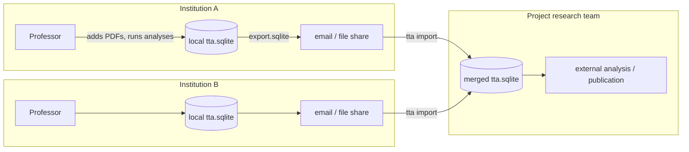
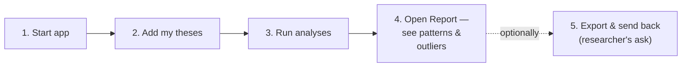
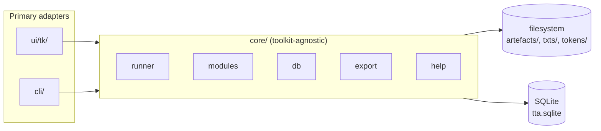
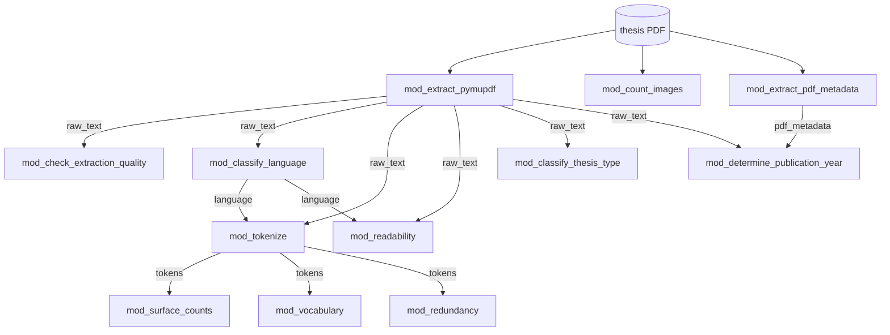
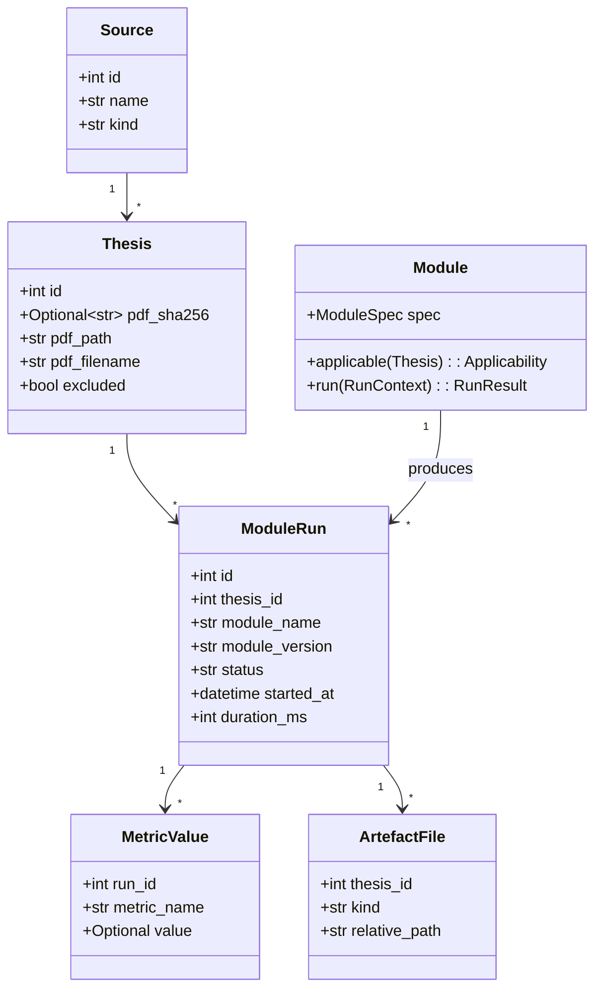
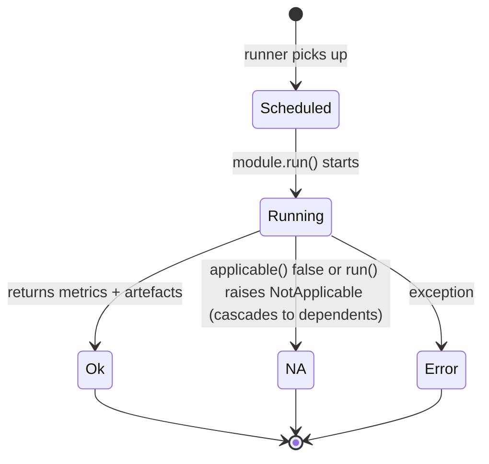

# 1. Introduction

## 1.1 Purpose

This document specifies the design of the **Thesis Text Analyzer**, a portable desktop application that computes per-thesis text metrics and tracks their evolution over publication date. The SDD is part of the project's end deliverable. Every design decision in this document is traceable to a user story ([§4](#4-user-stories)) or a quality attribute ([§10](#10-quality-attributes)); the rationale for each major decision lives in a numbered ADR under [`adr/`](adr/).

## 1.2 Scope

The MVP comprises:

- A core analysis library (`tta.core`) that runs analyses, persists results, and exports them — toolkit- and UI-agnostic.
- A graphical UI (`tta.ui.tk`) targeted at professors who provide thesis files.
- A command-line interface (`tta.cli`) targeted at researchers and developers. Its feature set is a **superset** of the GUI's: everything the GUI can do, the CLI can do, and the CLI may additionally offer researcher/developer options (e.g. the repository-specific rulesets of [ADR-0023](adr/0023-researcher-cover-rulesets.md)). Any other divergence between the two - a GUI-only feature, or a new CLI-only feature - is a deliberate decision recorded in an ADR ([ADR-003](adr/0003-cli-first-class.md) rev. 2026-11-17).

Out of MVP scope but architecturally accommodated: LM-based modules (perplexity, embedding burstiness), citation/quotation validity modules, smarter figure analysis, full i18n, plugin loaders. See [§12](#12-out-of-mvp-scope).

## 1.3 Definitions

| Term | Meaning |
|---|---|
| **Thesis** | A bachelor or master thesis, provided as a PDF file. The app also recognises other degree papers (diploma, magister, MAS, licentiate, semester paper, doctoral; [ADR-0019](adr/0019-thesis-type-by-detection.md) rev. 3) and reports them as such. |
| **Module** | An analysis unit that consumes artefacts and produces metrics and/or artefacts. Conforms to the `Module` ABC ([§6.2](#62-module-contract)). |
| **Metric** | A single scalar value (numeric or short text) computed for a thesis. |
| **Derived metric** | A metric computed from other metrics (e.g. Flesch reading ease from word, sentence, and syllable counts). |
| **Artefact** | An intermediate file produced by a module (e.g. extracted plain text). |
| **Artefact kind** | A documented identifier for the on-disk shape of an artefact (e.g. `raw_text`, `tokens`). Vocabulary in [`core/artefact_kinds.py`](#64-artefact-kinds-vocabulary). |
| **Run** | One execution of a module on a thesis; recorded in `module_runs`. |
| **Producer** | A module that produces a given artefact kind. Multiple producers per kind are allowed; the active one is selected by configuration ([ADR-005](adr/0005-producer-swap-deferred.md)). |
| **Source** | The provider of data in the database — either `local` (the user's own analyses) or `imported` (a researcher's import of a professor's export). |
| **Pipeline** | The directed acyclic graph of modules executed for one thesis. |

## 1.4 References

External (academic): Flesch (1948), Yule (1944), Amstad (1978), and others — see [`references.bib`](references.bib).

Internal: ADR documents under [`adr/`](adr/); user-story catalogue at [`user-stories.md`](user-stories.md); privacy registry at [`tta/core/privacy_metadata.py`](../tta/core/privacy_metadata.py); artefact kinds vocabulary at [`tta/core/artefact_kinds.py`](../tta/core/artefact_kinds.py).

---

# 2. System Overview

## 2.1 Research goals

In priority order:

1. **Primary** — Trace how thesis length has evolved across publication dates. The publication date is the **`publication_year` metric** — a best estimate fused by `mod_determine_publication_year` (#17) from the date the thesis states on its title page, read under defined rules ([ADR-0022](adr/0022-publication-date-rules.md), #81), and the PDF-metadata dates — **not** the raw PDF `creation_year`, which re-saves and repository processing make unreliable. `publication_year` is the x-axis of the report's length-over-time chart (§9.8); the companion metric `publication_date_precision` records whether the year came from a day, month, semester or year-only statement. The year stays the research axis; day and month are kept only locally.
2. **Secondary** — Trace and correlate other text metrics (vocabulary richness, readability, redundancy, structural features) against publication date and against each other, in support of the primary question.
3. **Tertiary** — Whether the public availability of generative AI tools (Nov 2022) coincides with any acceleration of the above trends.

### 2.1.1 Methodological output: library comparison study

The project produces a comparative evaluation of PDF text-extraction libraries (PyMuPDF, pdfminer.six, pypdf, pdfplumber, poppler `pdftotext`, …) on a thesis corpus, scoring them on:

- Extraction quality (presence of garbled output, faithfulness to layout, handling of footnotes, captions, equations).
- Resulting metric stability — do the same theses produce similar metric values across extractors?
- Resource footprint (time, memory).
- License compatibility with redistribution (informative only since [ADR-0017](adr/0017-license.md) adopts a copyleft licence — no longer a ship-blocking criterion).

Findings inform which extractor ships in the distributed `.exe` — selected on extraction quality, with the licence constraint removed by [ADR-0017](adr/0017-license.md) — and form a section of the planned publication. The architecture supports this study natively: alternative extractors are added as additional modules producing the same `raw_text` artefact kind, selected via `tta.toml` per run.

## 2.2 Distribution model

The application is sent to professors at multiple institutions. They run analyses on local thesis collections; results are written to a local SQLite database; an export is sent back to the research team. The research team imports each export as a distinct *source*, merging across institutions for cross-cohort analysis (see [ADR-006](adr/0006-schema.md), [ADR-007](adr/0007-export-format.md)).

## 2.3 Explicitly NOT goals

- **Per-thesis classification of "AI-influenced" vs "organic" authorship.** The exploration phase (see memory: `project_eth_text_analysis_findings`) showed that surface text metrics alone cannot make that distinction on academic prose, and the MVP will not claim to do so. AI detection is a possible application of the measurement substrate, not its purpose.
- **Network operation.** The application is fully offline. No telemetry, no remote update, no online dictionary lookup ([QA-PRIV](#qa-priv-privacy-local-only-no-pii-export)).
- **Plugin / runtime loading of third-party modules.** Modules are contributed via PR; new external researchers extending the catalogue follow the standard module contract. See [ADR-004](adr/0004-module-contract.md) and [§12](#12-out-of-mvp-scope).

---

# 3. Stakeholders and Operating Model

## 3.1 Personas

| Persona | Description | Default mode |
|---|---|---|
| **Professor** (primary) | Faculty at participating institutions. May be from non-technical departments; not necessarily technically versed. Owns thesis files. Uses the GUI. | Basic |
| **Power user** | Technically versed professors; researchers from the project team working on a specific cohort. Wants visibility into raw values and module configuration. | Extended (toggle in settings) |
| **Researcher** (project team) | Members of the project team; consumes exports from multiple sources; may also analyse their own theses. Uses CLI as primary interface; GUI as viewer. | Extended; CLI-first |

## 3.2 Operating model



The application binary is the same on every node; what differs is which sources exist in each local database (see [ADR-006](adr/0006-schema.md)).

## 3.3 The two happy paths

The application serves two stakeholders with overlapping but distinct goals. Acknowledging the difference avoids designing for one and accidentally compromising the other.

### 3.3.1 The researcher's contribute-data loop (US-RES-LOW-FRICTION)

What the researcher needs the professor to be able to do, in five low-friction steps:

```mermaid
flowchart LR
    S1[1. Start app] -->|"auto-opens last project"| S2[2. Select theses]
    S2 -->|"no dialog: add is instant, type is detected"| S3[3. Run all]
    S3 -->|"toolbar button, progress bar"| S4[4. Export]
    S4 -->|"save dialog, no extra choices"| S5[5. Send back]
    S5 -.->|"outside the app"| END[email / shared drive]
```



This is what motivates the **low-friction** design choices: auto-open the last project, sensible defaults, basic-mode toolbar with four core buttons, no extra checkboxes in the export dialog. Adding files is **instant and dialog-free** — the SHA-256 hash is deferred to first-run time ([ADR-0006](adr/0006-schema.md) rev. 4, #38) and the thesis type is **detected**, not entered ([ADR-0019](adr/0019-thesis-type-by-detection.md), #9). Every design choice gets reviewed against this: *does this add a step to the contribute loop?*

### 3.3.2 The professor's insights journey (US-PROF-INSIGHTS)

What actually motivates a professor to use the app voluntarily:



The professor's *reward* is in step 4 — the Report view ([§9.9](#99-report-view)) shows trends, comparisons, and outliers in their collection that they couldn't see by reading individually. Step 5 (export/send) is the researcher's interest; without step 4 there's no reason for the professor to engage.

The two journeys share the first three steps; they diverge at step 4. The researcher's "Export and send" is shifted to step 5 of the professor's path, framed as an optional thank-you rather than the goal.

---

# 4. User Stories

The full catalogue lives at [`user-stories.md`](user-stories.md). Each story has a stable identifier of the form `US-<persona>-<short>`. Identifiers are cited throughout the SDD and the ADRs.

Headline stories driving load-bearing decisions:

| ID | Story (abbreviated) | Drives |
|---|---|---|
| **US-PROF-INSIGHTS** | See interesting patterns / trends / outliers in my collection | Report view ([ADR-016](adr/0016-report-view.md)) |
| US-PROF-TRENDS | See how text characteristics evolved over years | Report → length-over-time chart |
| US-PROF-COMPARE | Compare bachelor vs master theses side-by-side | Report → length-by-type box plots |
| US-PROF-NOTICE | Have unusual theses surfaced | Report → outlier list |
| US-PROF-ATTRS | Group by thesis type (bachelor/master; other degree papers reported as such) | `mod_classify_thesis_type` (detected, [ADR-0019](adr/0019-thesis-type-by-detection.md)); correction via editable metrics (#10) |
| US-PROF-EXCLUDE | Exclude confidential theses | Schema, runner |
| US-PROF-EXPLAIN | Read explanations of metrics | Help system ([ADR-012](adr/0012-help-content.md)) |
| US-PROF-EXPORT | Export results into a single file | Export format ([ADR-007](adr/0007-export-format.md)) |
| US-PROF-QUALITY | See garbled extractions flagged in the grid | `mod_check_extraction_quality` |
| US-PROF-AUTO-OPEN | App remembers last project across runs | Startup resolution in `tta.core.project`, pointer in the default project's `tta.toml` (§5.6.1, [ADR-014](adr/0014-distribution.md)) |
| **US-PROF-NO-TRACES** | No writes outside the project folder by default | No `~/.config` state at all; write-path audit (§5.6.2, [ADR-014](adr/0014-distribution.md)) |
| US-PWR-EXTENDED | Extended mode with more settings | UI modes |
| **US-RES-LOW-FRICTION** | Contribute-loop fits in five low-friction steps | Distribution, export, defaults throughout the UI |
| US-RES-CLI | Run analyses from the CLI; use GUI only as viewer | CLI as first-class ([ADR-003](adr/0003-cli-first-class.md)) |
| US-RES-IMPORT | Import multiple exports; analyse grouped by source | Schema (`source_id`) |
| US-RES-LOCAL-RERUN | Run on own theses; imported data stays read-only | Runner filter on `source.kind='local'` |
| US-RES-OUTLIERS | Quickly identify outliers in the grid | UI highlighting |
| US-RES-LANG | Know what language a thesis is in | `mod_classify_language` |

---

# 5. Architectural Design

## 5.1 Hexagonal layering



[ADR-002](adr/0002-ui-core-boundary.md) makes this binding: `core/*` must not import from `ui/*` or `cli/*`. The boundary is CI-enforced. The CLI ships with MVP as a peer of the GUI whose feature set is a superset of the GUI's ([ADR-003](adr/0003-cli-first-class.md) rev. 2026-11-17).

## 5.2 Package layout

```
tta/                              # repository root
├── tta/                          # Python package (import root: `tta.*`)
│   ├── core/
│   │   ├── types.py              # Thesis + shared plain types (module contract lives in modules/base.py)
│   │   ├── events.py             # in-process pub/sub for progress
│   │   ├── db/                   # schema, migrations, repository
│   │   ├── modules/              # analysis modules — see §7
│   │   │   └── base.py           # Module ABC + ModuleSpec, RunContext, RunResult, Applicability
│   │   ├── artefact_kinds.py     # vocabulary of artefact kinds
│   │   ├── privacy_metadata.py   # source-of-truth for the GDPR statement
│   │   ├── third_party_licenses.py # locates the bundled THIRD_PARTY_LICENSES.txt (#36)
│   │   ├── runner.py             # dependency resolution + execution
│   │   ├── artefacts.py          # filesystem layer for cached files
│   │   ├── export.py             # anonymisation + export
│   │   ├── importer.py           # import researcher merge DB
│   │   ├── config.py             # tta.toml reader/writer
│   │   ├── cover_rules.py        # researcher ruleset loader (ADR-0023)
│   │   ├── help_corpus.py        # the one front-matter parser + corpus layout (§9.4)
│   │   └── help/                 # markdown content (see §9.4)
│   ├── ui/
│   │   └── tk/                   # Tk + tksheet UI ([ADR-001](adr/0001-ui-toolkit.md))
│   └── cli/                      # `tta` command-line ([ADR-003](adr/0003-cli-first-class.md))
├── tests/
│   ├── fixtures/                 # tiny sample PDFs
│   ├── core/                     # tested without any UI
│   ├── modules/                  # per-module unit tests (QA-TEST)
│   └── integration/              # exercises the CLI
├── tools/                        # developer tooling, never frozen into a binary (§5.6.5)
├── docs/                         # this SDD, ADRs, user stories
├── research/cover_rules/        # researcher rulesets (repository-specific rules), never packaged (ADR-0023)
└── pyproject.toml
```

CI invariants:

```
grep -rn "tta\.ui\|from \.\. import ui\|from \.\.ui" tta/core/ tta/cli/    → no results
grep -rn "tta\.cli\|from \.\. import cli\|from \.\.cli" tta/core/ tta/ui/  → no results
```

(The former AGPL release-gate invariant — no `import fitz`/`import pymupdf` under `tta/core/` — is **retired by [ADR-0017](adr/0017-license.md)**: PyMuPDF ships under the project's copyleft licence. Only the two boundary invariants above remain.)

## 5.3 Module pipeline (DAG)



Three "root" modules read the PDF directly; everything else flows downstream from `mod_extract_pymupdf` and `mod_classify_language`. `mod_classify_thesis_type` (#9) sits off `raw_text` next to `mod_check_extraction_quality`; `mod_determine_publication_year` (#17, #81) fuses two upstreams — `raw_text` (the date stated on the title page) and the `pdf_metadata` artefact (PDF `creation_year`/`modification_year`). Detailed module specs in [§7](#7-module-catalogue).

## 5.4 Persistence

- **Database** — one SQLite file (`tta.sqlite`) at the project root. Schema in [§8.1](#81-database-schema). Append-only history on `module_runs` and `metric_values`.
- **Artefact filesystem** — `<project>/artefacts/<thesis_id>/<run_id>/<kind>.<ext>` ([ADR-006](adr/0006-schema.md)). Files referenced by relative path in `artefact_files`.
- **Configuration** — `<project>/tta.toml`. Worker count, user preferences. (Producer selection is omitted in MVP — see ADR-005.)

## 5.5 Runner orchestration

Decision: [ADR-013](adr/0013-runner-orchestration.md). The runner splits into a deterministic **plan** phase (returns a `RunPlan` data structure; side-effect-free) and a stateful **execute** phase (events + DB writes).

- Up to `workers` theses run concurrently, each in a worker process spawned directly by the scheduling loop (not a `ProcessPoolExecutor`); modules within a thesis run serially in topological order. **Workers are long-lived** (#86): one per slot, each takes one thesis after another from its own task queue, so nltk/textstat/langdetect/PyMuPDF load once per worker rather than once per thesis (median 3.0 s -> 1.1 s per thesis in the exp-86 trial, identical results). A worker that had to be killed (timeout, deadline, cancel) or died is dropped and replaced lazily, when the next thesis needs one; idle workers are shut down (sentinel, join, terminate fallback) as soon as nothing is pending and, in a `finally`, whenever `execute` exits - normally, on cancel or through an exception - so no worker outlives the run. Workers ignore SIGINT (Ctrl-C is the main process's cancel) and an idle worker exits when its parent is gone. As a safeguard a worker is **recycled** after `[runner] recycle_after_theses` (default 250) theses or when its resident set after a thesis exceeds `recycle_above_rss_mb` (default 1024 MiB, ADR-015's per-worker budget; stdlib probe on Windows and Linux, count only on macOS); `0` disables either. See [ADR-013 Worker reuse](adr/0013-runner-orchestration.md#worker-reuse).
- Workers compute results in isolation; the main process is the sole DB writer (commit per thesis, single transaction).
- Cancellation = skip-pending **with a bounded grace** (#57): no new theses start, an in-flight thesis gets `[runner] cancel_grace_s` (default 2 s) to finish, then its worker is terminated. Worst case from click to control returning is the grace plus the join timeouts (~12 s), not one full thesis per worker (~30–120 s). Outcomes already received are committed; modules that never reported get **no row** - a cancelled pair stays `missing` so ADR-0015's pause/resume resumes against a clean history - but do emit `ModuleCompleted(status="skipped")`. See [ADR-013 Cancellation](adr/0013-runner-orchestration.md#cancellation).
- Two nested timeouts kill stuck workers: **per module** (default 300 s) and **per thesis** (default 600 s, wall-clock from the thesis's hand-over to its worker; ~10x the slowest legitimate per-thesis figure implied by [ADR-015](adr/0015-performance-budget.md)). The per-module guard alone left one document able to burn `timeout x modules attempted`, up to ~60 min (#56). Both are settable as `[runner] module_timeout_s` / `thesis_timeout_s` in `tta.toml` ([ADR-013 Timeouts](adr/0013-runner-orchestration.md#timeouts)).
- Failures cascade as `na` to dependents. A module *independent* of the failure gets no row at all and stays `missing` for the next run, but still emits a `ModuleCompleted(status="skipped")` so an adapter's pair accounting closes (#55). A worker that dies without reporting (`is_alive()` false, no `thesis_done`) is a terminal failure of the module in flight and runs the same cascade - otherwise the run polls forever. Full policy: [ADR-013 Failure policy](adr/0013-runner-orchestration.md#failure-policy).
- Default workers: `max(1, os.cpu_count() - 1)`.
- Events: `HashingProgress`, `RunStarted`, `ThesisStarted`, `ModuleStarted`, `ModuleCompleted`, `ThesisCompleted`, `RunCompleted`, `RunCancelled`. `HashingProgress(done, total)` precedes `RunStarted`: it covers the deferred-hash pass ([ADR-006](adr/0006-schema.md), #59), which is real work on a large corpus and used to display as a silent "Planning..." even though `plan()` never hashes or reads a file (#59). Adapters subscribe; main process publishes (workers do not). `ModuleCompleted.status` is `ok | na | error | skipped`; every pair in the `RunStarted` plan is followed by exactly one `ModuleCompleted`, whatever happens to its worker.
- **Progress + size-weighted ETA (#39, #54, #58).** From the event stream an adapter drives a determinate progress bar and a remaining-time estimate. The bar still **advances per `(thesis × module)` pair** - the finer granularity is what keeps it moving smoothly - but the **label counts theses**, `n/N`, because "(thesis × module) pairs" is meaningless to the professor persona (#58). `Progress` therefore carries `theses_done`/`theses_total` beside the pair counts; `theses_total` is `len(plan.theses)`, and `theses_done` is derived from the distinct thesis ids still in the remaining set (so the estimator is self-sufficient), taking the adapter's `ThesisCompleted` tally instead when that is further ahead (so a thesis killed without its pairs reporting still counts). The pair count is a power-user detail, shown only in extended mode ([§9.2](#92-main-window-layout)). The estimate is computed by pure, toolkit-free functions in `core/progress.py` (`estimate`, `damp_eta`, `fit_cost`, `blend_cost`, `prior_cost`), toolkit-free and unit-tested without a display. It is driven by the **GUI only** today: the CLI prints one line per module completion and has no bar or estimate (#73 corrected this sentence, which claimed both adapters used it). Giving the CLI a renderer needs the bookkeeping that currently lives in `main_window` - the merged-cost model, the in-flight elapsed times, the damping - lifted into core beside `estimate`; until then `progress.py` is reusable in principle, not in fact. `progress.py` never reads the clock — the caller passes wall-clock elapsed and the worker count in.
    - **Affine cost model, not a pure rate.** Each module's cost for one thesis is `intercept_ms + slope_ms_per_byte × pdf_size_bytes`. Part of per-thesis cost is *constant* (fixed per-document setup) and several modules are page- or token-driven rather than byte-driven, so a model through the origin is wrong. `Repository.module_duration_stats` fits `(intercept, slope)` per module by least squares over that module's past **successful (`ok`)** runs with a positive recorded size, and returns non-negative coefficients (a negative-slope fit degrades to intercept-only, a negative-intercept fit to slope-only). With observations at only **one distinct size** it reports intercept-only: one size is no evidence of size dependence, and treating it as a rate is what let a single small thesis inflate the estimate for every large one (#54).
    - **Per-module priors, not the mean of the known rates.** A module with no history uses a **per-module prior**, split evenly between intercept and slope at a nominal median-thesis size (2 MB, the exp-86 sample's median); modules absent from the table use a documented default (100 ms). Since #86 the priors are the **measured warm-worker means** (the exp-86 sample of 200 theses on one reused worker, with `mod_count_images` counting without decoding, #85; the worker's first thesis excluded; ~0.83 s per thesis in sum, median thesis ~0.71 s), not [ADR-0015](adr/0015-performance-budget.md)'s budget table: the budgets are ceilings (15 s per thesis) that contained the per-thesis library start-up, so as priors they overstated a first run's estimate many times over. Means, not medians, because an estimate sums expected costs and several modules have a long tail. The in-run blend corrects a prior that is off for the machine within a few observations. Pricing every not-yet-reported module at the *mean of the rates already known* is the defect that made the ETA start grossly inflated and then move non-monotonically: on a first run, once only `mod_extract_pymupdf` had reported, all 11 remaining modules were priced at the extractor's rate (#54). In-run observations are **blended** into the history/prior model by sample weight (`blend_cost`) rather than overwriting it.
    - **Parallelism.** `Runner.execute` runs up to `workers` theses concurrently while the modules *within* a thesis are serial, so remaining work is bucketed **per thesis** and the estimate is the makespan bound `max(total_remaining / min(workers, remaining theses), longest single remaining thesis)` — a per-thesis critical path against a worker-count division. Dividing by `workers` flat would underestimate the tail of a run; summing all remaining pairs serially (the original formula) overstated wall clock by roughly the worker count (#54).
    - **Worker start-up is a one-off (#86).** Workers are long-lived ([ADR-0013](adr/0013-runner-orchestration.md#worker-reuse)), so library start-up is paid once per worker, not per thesis. The workers start in parallel, so `estimate` adds it **once** to the makespan (`startup_ms`); the GUI passes `WORKER_STARTUP_MS` (~2.1 s, measured as the per-thesis wall-clock difference between fresh and reused workers on the same sample) minus the run's elapsed time, so the term counts down to zero at the start of the run. Observations from the first `workers` theses of the plan - the ones handed to fresh workers, which carry the start-up inside their module timers - are left out of the in-run fit. Replacement workers after a kill or a recycle pay the start-up again; they are rare and not modelled.
    - **It counts down.** The caller passes the **in-flight** pairs with their elapsed seconds; such a pair contributes `max(cost - elapsed, 0)`, so its share shrinks as it runs. The adapter re-renders on every poll tick, not only on `ModuleCompleted`, so the number decays between events instead of freezing. Successive estimates are damped (`damp_eta`: a fall is shown at once, a rise is eased in) so the label reads as a countdown rather than jumping when a module lands.
    - **A document that timed out is floored at its timeout.** `module_duration_stats` fits only **successful** runs, so a module killed by the timeout contributes nothing and the next run would estimate that thesis just as optimistically and be wrong the same way. The estimator therefore takes a per-thesis floor (`Repository.thesis_cost_floors`): for each thesis that carries a timed-out run, its remaining bucket is floored at the longest timeout recorded against it. The floor is deliberately **per thesis, not per module** (#56): a hang is a property of the one document that hung - a corrupt or pathological PDF - and letting one environment failure re-price that module for every thesis in the database would be worse than the optimism it fixes. A thesis whose ordinary estimate already exceeds the floor is unaffected.
    - Before the run has produced any evidence at all (no history, no completed pair, no in-flight elapsed) the bar advances with no ETA number ("estimating..."). The GUI renders this inline in the run area beside the Cancel control ([§9.2](#92-main-window-layout)); the CLI's progress goes to stderr.

Two run modes for MVP:

- **Default** ("Run all"): missing + stale + previously-errored `(thesis × module)` pairs.
- **`--rerun`**: everything regardless of state.

A `--dry-run` flag prints the plan without executing.

## 5.6 Distribution

Decision: [ADR-014](adr/0014-distribution.md). Per-OS single-file PyInstaller `--onefile` binaries built on CI. Stateless binary + project directory. No auto-update. Only the GUI binary is released; the CLI is frozen in CI as the acceptance-test vehicle and reaches its users (research team, power users) from source ([ADR-003](adr/0003-cli-first-class.md) revision 2026-10-12).

On first launch the app creates `~/TTA-Theses/` (or platform equivalent) as the default project and shows a dismissible banner. Subsequent launches auto-open the last project (US-PROF-AUTO-OPEN). By default the app writes **nothing** outside the project folder (US-PROF-NO-TRACES, [ADR-014](adr/0014-distribution.md)); the last-project pointer lives inside the default project, so deleting the folder removes every trace and no `~/.config/tta` file is created. (The AGPL release-gate that previously forbade `import fitz`/`import pymupdf` under `tta/core/` is retired by [ADR-0017](adr/0017-license.md): the project adopts a copyleft licence, so PyMuPDF ships as-is.)

### 5.6.1 Startup project resolution

`tta.core.project` owns the resolution; both adapters go through it, so neither reimplements it and nothing UI-specific is involved (ADR-0002).

The **last-project pointer** is the key `last_opened` in the `[project]` table of the *default* project's `tta.toml`. It is the only pointer the app keeps, it is a project file like any other, and it is absent unless the user has actually opened a project elsewhere. Startup resolves in this order:

1. Read `[project].last_opened` from `<default>/tta.toml` — a plain `load_config`, which creates nothing when the file or the folder is missing. A non-string value is ignored.
2. If the pointer is set **and the directory it names still exists**, that is the target. The directory need not already contain a `tta.sqlite`: the user may point File → Open at an empty folder, and the app then creates the project there. If the directory is *gone* the pointer is stale — the user deleted the project, which the no-traces guarantee says must leave nothing behind — so it is ignored and the default project is the target.
3. Otherwise the default project is the target.
4. The target is opened with `create=True`. **If that open fails for any reason** — a corrupt or foreign `tta.sqlite`, a failed migration, a permission or path error — the app does **not** abort: it falls back to the default project and surfaces the reason in the startup banner. Without this the failure is unrecoverable, because the pointer keeps selecting the same broken target on every subsequent launch and the user has no visible way to reset it.

`first_launch` means "the target had no `tta.sqlite` and we just created it", which is when the banner naming the project folder is worth showing — the true first launch, and equally the first launch into a newly chosen empty folder.

Opening a project **is** the act of remembering it: the pointer is written when the user chooses a folder via File → Open, and cleared when the chosen folder is the default project (no self-pointer). Writing the pointer creates the default project folder if needed, since that folder is the anchor the pointer lives in.

### 5.6.2 Write-path audit (US-PROF-NO-TRACES)

Everything persistent lives under the project directory: `tta.toml`, `tta.sqlite`, the defensive `tta.sqlite.bak.<version>`, `artefacts/`, and `exports/`. One further path was found outside it and is handled here:

- **Transient scratch space.** The runner gives each module a `tempfile.mkdtemp` workdir and removes it in a `finally` after the module returns, and a frozen `--onefile` binary unpacks itself into a temporary directory that the bootloader cleans up on exit. Both are transient scratch, not persistent state, and both are accepted rather than relocated — noted in the release notes for honesty.

OS-level caches that any GUI process touches (fontconfig, GPU shader caches) are outside the application's control and outside this guarantee.

### 5.6.3 Development environment (Linux and native Windows)

Development happens on Linux and on **native Windows** — the platform the GUI is mostly *used* on, so it is a development platform in its own right rather than only a packaging target. Both run the same gate: CI's `lint-and-test` job runs the full suite, the coverage gate and the source invariants on `ubuntu-latest` and on `windows-latest` (QA-PORT, QA-TEST). On Windows the GUI tests in `tests/ui` run against the desktop session directly; Linux needs X11/Wayland or Xvfb.

- **Environment.** A conda env `pds` with Python 3.12 (Miniconda's Python ships Tcl/Tk, so `tkinter` works natively on Windows), holding the package editable with its declared extras plus the coverage plugin — `pip install -e ".[dev,build]" "pytest-cov>=5"` — and the NLTK data the modules need, `python -m nltk.downloader punkt_tab cmudict`. Nothing undeclared goes into it (cf. ADR-014's clean-environment clause).
- **Line endings.** `.gitattributes` pins every text file to **LF in the working tree on every OS** (`* text=auto eol=lf`; the compiled `.mo` and other binary formats are `binary`). Git for Windows defaults to `core.autocrlf=true`, which without it checks out CRLF and breaks byte-exact tests, the `.po`/`.mo` gate and shebangs. No per-clone git configuration is required.
- **OS-neutral tests.** Paths are compared as `Path` objects or via `as_posix()`, never as `str` with `/`; files are read and written with an explicit encoding; a test that reads a subprocess's output pins the pipe encoding on *both* ends; nothing relies on symlinks (Windows refuses them without Developer Mode) or on POSIX permission bits. A test that is inherently POSIX-only skips with a reason string. Two Windows/Tk specifics are handled once, in `tests/ui/conftest.py`: the display gate only consults `$DISPLAY` on X11 platforms, and Tcl's standard channels are created on private handles before the first interpreter, because pytest's fd-level capture closes the process std handles under Tcl on Windows.
- **Local frozen builds** follow ADR-014 in a throwaway environment with `PYTHONNOUSERSITE=1`. A conda environment must be **activated** (or driven through `conda run -n <env> pyinstaller ...`) while PyInstaller runs: it resolves the DLLs an extension module links against through `PATH`, and with only a base Miniconda on `PATH` it bundled the base installation's `libexpat.dll` beside the build env's `pyexpat.pyd`. That binary built and passed every size and graph gate, then failed on launch with "DLL load failed while importing pyexpat". CI's setup-python interpreter links expat statically and is not exposed to this.

### 5.6.4 CI pipeline

One GitHub Actions workflow, `.github/workflows/ci.yml`, runs on every push, every pull request, every `v*` tag and on demand (`workflow_dispatch`). It has three jobs:

| job | runs | for |
|---|---|---|
| `lint-and-test` | Linux + native Windows (§5.6.3) | source invariants (boundary, [ADR-002](adr/0002-ui-core-boundary.md); ASCII, [ADR-018](adr/0018-ascii-source.md)), the full suite with the QA-TEST coverage gate, the GUI tests under Xvfb on Linux |
| `build` | four targets, after `lint-and-test` | clean-environment freeze, size/graph/licence gates, packaged-binary acceptance ([ADR-014](adr/0014-distribution.md)); uploads `tta-gui` for tags and manual runs only |
| `release` | `v*` tags only | collects the four artefacts into a **draft** release |

**The reference for what each step does and why is the comment above that step in `ci.yml`**, next to the code it explains; this section does not repeat it. `tests/packaging/test_ci_workflow.py` pins the gates themselves, so removing one fails the fast suite.

**Action runtimes.** Only GitHub's own JavaScript actions are used (`checkout`, `setup-python`, `upload-artifact`, `download-artifact`), each pinned to a major tag whose `action.yml` declares `runs.using: node24`. GitHub deprecated the Node 20 runtime in 2025 and forces Node 20 actions onto Node 24 with a warning on every job; a major that still declares `node20` is therefore not used, and the suite rejects one (#35). To bump: read `runs.using` in the new major's `action.yml` and its release notes for breaking changes, before changing the tag.

### 5.6.5 Documentation screenshots

The screenshots of the GUI, the HTML report and the CLI used in the project documentation are produced by `tools/screenshots.py`, not by hand, so they can be regenerated after every UI change and stay comparable between runs. It is developer tooling in the sense of `packaging/`: not part of the `tta` package, not frozen into either binary, and with **no dependency beyond the dev environment** of §5.6.3.

- **Demo data, never user data.** The tool generates synthetic PDFs (PyMuPDF, already in the `dev` extra) with invented titles and placeholder authors, builds a fresh project from them in a scratch directory and opens it directly with `Project.open` - not through `open_startup_project` - so neither the user's default project nor its last-project pointer is read or written (US-PROF-NO-TRACES). Its only writes are that scratch project and the output directory.
- **Fixed conditions.** German UI (`[ui] locale = "de"` in the demo project, ADR-0020), fixed window sizes, a fixed worker count and a fixed report timestamp (`REPORT_TIMESTAMP`, 30 April 1916 10:24 - Claude Shannon's birthday, at 2^10 minutes past midnight). The in-progress image pauses the run thread on a gated event queue after a set number of finished theses, so it does not depend on timing.
- **Capture.** Tk windows and the native export message box are captured with Win32 `PrintWindow` through `ctypes` and written as PNG by a small stdlib encoder (Pillow stays out, ADR-0014). The report and the CLI transcript - rendered by rich as SVG - are rasterised by a headless Chromium-family browser (Edge on Windows) running on a throwaway profile. Windows is the supported platform; the browser-rendered images also work on Linux.
- **Selections.** `--only NAME ...` builds a subset; `--readme` builds the four images the repository README shows (main window after a run, report, help viewer, CLI). The details-panel image shows an `error` cell, because an `ok` cell opens no panel (§9.9).
- **GUI hooks.** None: everything is driven through the `MainWindow`, `GridView` and help-viewer methods the GUI tests already use. A UI change that breaks the tool is caught by its smoke test (`tests/ui/test_screenshots_tool.py`, display-gated like the other GUI tests).

---

# 6. Domain Model

## 6.1 Core entities



## 6.2 Module contract

Defined in `core.modules.base`:

```python
@dataclass(frozen=True)
class ModuleSpec:
    name: str
    version: str
    consumes: tuple[str, ...] = ()             # artefact kinds
    produces_artefacts: tuple[str, ...] = ()   # artefact kinds
    produces_metrics: tuple[str, ...] = ()     # metric names

@dataclass
class RunContext:
    thesis: Thesis
    artefacts: dict[str, Path]                  # consumed artefacts by kind
    workdir: Path                               # where to write produced artefacts

@dataclass
class RunResult:
    metrics: dict[str, Any] = field(default_factory=dict)
    artefacts: dict[str, Path] = field(default_factory=dict)
    diagnostics: dict[str, Any] = field(default_factory=dict)

@dataclass
class Applicability:
    ok: bool
    reason: str | None = None

class NotApplicable(Exception):
    """Raised from run() when applicability depends on consumed artefact
    content (e.g. the detected language); recorded as `na` with the
    exception message as reason."""

class Module(ABC):
    spec: ModuleSpec
    def applicable(self, thesis: Thesis) -> Applicability: ...
    @abstractmethod
    def run(self, ctx: RunContext) -> RunResult: ...
```

`applicable()` covers checks that need only the `Thesis` row (e.g. file extension); data-dependent checks from the applicability matrix ([§7.2](#72-applicability-matrix)) — detected language, minimum text length — happen inside `run()` via `NotApplicable`, since consumed artefact content is not available before execution.

`RunResult.diagnostics` is free-form diagnostic context that is neither a metric nor an artefact (e.g. the stop-word ratio behind an `extraction_quality` verdict). It is persisted as JSON in `module_runs.diagnostics` for local inspection, but — because it may contain content-derived values — it is always stripped from exports ([§8.3.1](#831-anonymisation-rules)).

Decisions: [ADR-004](adr/0004-module-contract.md) for the contract, [ADR-005](adr/0005-producer-swap-deferred.md) for producer-swap semantics.

## 6.3 Run lifecycle



`NA` cascades: a thesis whose `mod_classify_language` reports a language not in `{en, de}` will produce `NA` outcomes for `mod_readability` and `mod_tokenize`, which in turn cascades to all `tokens`-consuming modules. The grid shows distinct visual states for `ok`, `NA`, and `error`.

## 6.4 Artefact kinds vocabulary

Four kinds in MVP. The vocabulary file (`core/artefact_kinds.py`) is the documented source of truth; module declarations are checked against it at registration.

| Kind | Format | Producer (MVP) | Privacy class |
|---|---|---|---|
| `raw_text` | UTF-8 plain text file | `mod_extract_pymupdf` | Content (PII risk; never exported) |
| `language` | JSON: `{"code": "en", "confidence": 0.99}` | `mod_classify_language` | Metric (no PII) |
| `tokens` | JSON: `{"sentences": [["w","w"],…], "language": "en"}` | `mod_tokenize` | Content (PII in aggregate; never exported) |
| `pdf_metadata` | JSON: full PDF Info dict + XMP | `mod_extract_pdf_metadata` | Identifying (may include author/title; never exported) |

Artefact files are stored under the filesystem layout in [§5.4](#54-persistence) and never travel in exports ([ADR-007](adr/0007-export-format.md)).

---

# 7. Module Catalogue

Thirteen modules, thirty-two metrics. See [ADR-011](adr/0011-mvp-module-catalogue.md) for the catalogue decision; each module also has a help page at `core/help/modules/<name>.md`.

## 7.1 Overview

| # | Module | Inputs (artefacts) | Produces (artefacts) | Produces (metrics) | Notes |
|---|---|---|---|---|---|
| 1 | `mod_extract_pymupdf` | — (PDF directly) | `raw_text` | `text_chars`, `n_pages` | PyMuPDF (AGPL); ships under the project copyleft licence (ADR-0017) |
| 2 | `mod_check_extraction_quality` | `raw_text` | — | `extraction_quality` (text: `ok`/`garbled`/`sparse`) | heuristic from `harvester/GARBLED_EXTRACTIONS.md` |
| 3 | `mod_classify_language` | `raw_text` | `language` | `language_code`, `language_confidence` | langdetect |
| 4 | `mod_tokenize` | `raw_text`, `language` | `tokens` | — | NLTK punkt_tab |
| 5 | `mod_surface_counts` | `tokens` | — | `word_count`, `char_count_alpha`, `sentence_count`, `avg_word_len`, `avg_sentence_len`, `std_sentence_len` | stdlib |
| 6 | `mod_vocabulary` | `tokens` | — | `ttr`, `root_ttr`, `hapax_token_ratio`, `hapax_type_ratio`, `yules_k` | stdlib; both hapax variants (V1/N and V1/V) ship for comparison |
| 7 | `mod_readability` | `raw_text`, `language` | — | `flesch_reading_ease` | textstat (Flesch en / Amstad de) |
| 8 | `mod_redundancy` | `tokens` | — | `bigram_repetition_rate`, `trigram_repetition_rate` | stdlib |
| 9 | `mod_count_images` | — (PDF directly) | — | `n_images` | pypdf object model; counts from the PDF structure, **never decodes an image**, ignores images under 3 px per side (#85, [ADR-0021](adr/0021-image-counting.md)). Counting rule below the table and in [§7.4](#74-notes-on-specific-modules) |
| 10 | `mod_extract_pdf_metadata` | — (PDF directly) | `pdf_metadata` | `page_count_meta`, `producer_category`, `creator_category`, `creation_year`, `modification_year`, `has_outline` | pypdf |
| 11 | `mod_classify_thesis_type` | `raw_text` | — | `thesis_type` (text: `bachelor`/`master`/`diploma`/`magister`/`mas`/`licentiate`/`semester`/`doctoral`/`unspecified`) | marker heuristic over the first five own pages, "type markers v1" (#9, #67, #82, ADR-0019 rev. 3, [`titlepage-rules.md`](titlepage-rules.md)); evidence in `diagnostics` |
| 12 | `mod_determine_publication_year` | `raw_text`, `pdf_metadata` | — | `publication_year` (num), `publication_year_source` (text), `publication_date_precision` (text: `day`/`month`/`semester`/`year`/`year_range`) | the title-page date under "date rules v1" (primary) fused with PDF `creation_year`/`modification_year` (#17, #81, [ADR-0022](adr/0022-publication-date-rules.md), [`titlepage-rules.md`](titlepage-rules.md)); winning source and precision in metrics, the full date and the evidence in `diagnostics` |
| 13 | `mod_extract_filesystem_metadata` | — (PDF path directly) | — | `file_size_bytes` (num), `fs_modified_year` (num) | stdlib `os.stat`; run-time file size + mtime year. Weak, easily-reset signals (#18) — see [§7.4](#74-notes-on-specific-modules) |

**Counting rule for `n_images`** (#9, #85). `n_images` is the sum over all pages of the number of images *available to* the page, read from the PDF structure only; no image is ever decoded and Pillow is not a dependency. Per page it counts (a) every **distinct image XObject** (`/Subtype /Image`) reachable from the page's `/Resources` `/XObject` dictionary, recursing into **Form XObjects** and their own resources at any depth, and (b) every **inline image** (`BI` ... `ID` ... `EI`) in the page's own content stream(s); inline images inside Form XObjects are not counted. An image XObject reachable from several pages counts **once per page**; one reachable several times on the same page (drawn twice, listed under two names, or in the page and in a form) counts **once**. An image counts only if **both its pixel width and height are at least 3** (`/Width`/`/Height`, inline `/W`/`/H`); an image whose size cannot be read does not count, and the drawn size on the page plays no role. The rule, the corpus data that grounds the 3 px threshold and the timing evidence are decided in [ADR-0021](adr/0021-image-counting.md); details, deviations from the 0.1.0 count and robustness in [§7.4](#74-notes-on-specific-modules).

The third-party libraries named in the *Notes* column are inventoried — name, purpose, version,
licence — in [`dependencies.md`](dependencies.md), which doubles as the one-time
GPL-3.0-or-later compatibility audit [ADR-0017](adr/0017-license.md) calls for (#37). What those
libraries and formulas get *wrong*, and which metrics must therefore be read with caution, is
documented in [`model-limitations.md`](model-limitations.md) (#43). The MVP uses **no LLM**; the
only trained/statistical components are NLTK punkt, langdetect, and the Flesch/Amstad syllable
heuristics.

## 7.2 Applicability matrix

| Module | Applicable when | N/A reason if not |
|---|---|---|
| `mod_extract_pymupdf` | file extension is `.pdf` | not a PDF |
| `mod_check_extraction_quality` | `raw_text` exists | upstream extraction failed |
| `mod_classify_language` | `raw_text` exists and has ≥ 200 chars | text too short for confident detection |
| `mod_tokenize` | `language.code` ∈ {`en`, `de`} **and** `raw_text` yields at least one sentence | unsupported language / no sentences in text (an empty `tokens` artefact is never written) |
| `mod_surface_counts` / `mod_vocabulary` / `mod_redundancy` | `tokens` exists | upstream NA cascade |
| `mod_readability` | `language.code` ∈ {`en`, `de`} | no Flesch formula for language |
| `mod_count_images` | file is a PDF | not a PDF |
| `mod_extract_pdf_metadata` | file is a PDF | not a PDF |
| `mod_extract_filesystem_metadata` | the file still exists at its recorded path | file not found |
| `mod_classify_thesis_type` | `raw_text` exists | upstream extraction failed (garbled/sparse text still yields `unspecified`, never `na`) |
| `mod_determine_publication_year` | `raw_text` and `pdf_metadata` exist | upstream NA cascade (no title-page date and no PDF date still yields an `ok` run with `publication_year` and `publication_date_precision` NULL and `publication_year_source='none'`) |

## 7.3 Library comparison study placement

Alternative producers for `raw_text` (`mod_extract_pdfminer`, `mod_extract_pypdf`, `mod_extract_pdfplumber`, `mod_extract_poppler`) are added during the project for the comparison study described in [§2.1.1](#211-methodological-output-library-comparison-study). They share the artefact kind but live in separate module files. **In MVP, exactly one producer per kind is registered**; comparing different libraries is done by swapping registrations and re-running into a separate database (per ADR-005). Runtime selection via config or CLI is deferred ([§12](#12-out-of-mvp-scope)).

## 7.4 Notes on specific modules

**`mod_extract_pymupdf`** is the initial implementation. The AGPL release gate that previously required replacing it before the first distributed `.exe` is retired by [ADR-0017](adr/0017-license.md) (the project adopts a copyleft licence, so PyMuPDF may ship); alternative extractors are now compared on quality, not licence ([§2.1.1](#211-methodological-output-library-comparison-study)).

**`mod_tokenize`** must never produce an **empty `tokens` artefact**: three of the thirteen modules read `tokens` (`mod_surface_counts`, `mod_vocabulary`, `mod_redundancy`) and between them carry thirteen of the thirty-two metrics, so an empty-but-`ok` artefact would silently zero out nearly half the catalogue (#34). Two failure modes are therefore made loud rather than silent. (1) If segmentation yields no sentences at all (empty, whitespace-only or word-less `raw_text`), the module raises `NotApplicable` and the run is recorded `na` with a reason — dependents cascade to `na` honestly instead of measuring nothing. (2) If the bundled NLTK **punkt_tab** model cannot be resolved, the module raises a `RuntimeError` naming the missing model, the language and the searched data paths. This is an environment defect, not a property of the thesis, so it is an `error` outcome, never `na`. The message is re-worded deliberately: NLTK's own `LookupError` advises `nltk.download()`, which is wrong here — the model is bundled at build time ([ADR-0014](adr/0014-distribution.md)) and the app never downloads anything (QA-PRIV). Its text also opens with blank lines, so the runner's one-line `reason` ([§6.3](#63-run-lifecycle)) degraded to a bare `LookupError:` with no diagnostic content — the actual defect behind #34.

**`mod_readability`** must never reach the network (#75, QA-PRIV). `textstat` uses NLTK's **CMUdict** corpus for English syllable counting and, when it is absent, calls `nltk.download('cmudict', quiet=True)` on its own - an outbound connection the application promises never to make, with the failure silently swallowed. The module therefore disables `nltk.download` for the duration of the textstat call, so no attempt is possible even on a machine that lacks the corpus, and converts the resulting `LookupError` into an `error` whose message names `cmudict` and how to obtain it. German is unaffected (CMUdict is English-only) and keeps working without it; English cannot be computed without it and says so rather than failing obscurely. Release builds bundle the corpus ([ADR-014](adr/0014-distribution.md)), so this path is a from-source concern only. It must also leave **no per-text state** behind (#86): workers are long-lived ([ADR-013 Worker reuse](adr/0013-runner-orchestration.md#worker-reuse)), and textstat's per-text `lru_cache`s plus pyphen's unbounded per-word hyphenation cache grew a worker by ~2.4 MB per thesis. Both are pure caches, so the module clears them after every run (results unchanged, version unchanged). The clearing reaches into library internals and is therefore defensive: whatever it cannot find in a future textstat/pyphen it skips, and it never fails the run.

**`mod_check_extraction_quality`** flags but does NOT block downstream modules. A thesis flagged `garbled` still has all subsequent metrics computed; the grid renders the row with a warning glyph `[!]` in the **State** lead column, and double-clicking that cell opens the details panel ([Sec. 9.9](#99-grid-cell-render-states)).

**`mod_count_images`** (0.2.0, #85) counts images **without decoding them** (owner decision: images are only counted; nothing in the app uses decoded image data). Version 0.1.0 used pypdf's `page.images`, which parses the whole content stream and decodes every inline image through Pillow: an undeclared dependency ("pillow is required" errors in an environment without it) and the slow, memory-hungry tail on scanned and poster-like PDFs (minutes per thesis, pypdf `LimitReachedError`). 0.2.0 walks pypdf's object model instead and applies the counting rule stated under [§7.1](#71-overview) and decided in [ADR-0021](adr/0021-image-counting.md):

- **What is counted.** Image XObjects reached through `/Resources` `/XObject` of the page and, recursively, of every Form XObject (Form XObjects are tracked in a per-page visited set, so a cycle of forms that reference each other terminates). Inline images in the page's own content stream(s) only, as in 0.1.0. Inline images inside Form XObjects are deliberately **not** counted: Ghostscript-converted figures (typical of `dvips`/`ps2pdf` graphics included by pdfTeX) draw every rule and line as a 1x1 inline stencil mask, so counting them turned one thesis of the exp-22 A128 sample from 0 into 5,686 images - noise, not figures - and it would require decompressing every form's content. Only the page content *streams* are decompressed (their `/Filter`, e.g. Flate); image data, XObject or inline, is never decoded or even decompressed, and Form XObject content is not read at all.
- **Minimum size.** Both pixel sides must be at least 3 (`MIN_IMAGE_SIDE_PX`, a module constant, not a setting). On the exp-22 corpus (840,450 counted images) the 1 px spike and its 2 px tail are 35.8 % of all images and, in a rendered sample, contained only rules, dotted lines, 1x1 masks and 1-2 px slices of logos; from 3 px on real image content dominates (ADR-0021, with the size distribution and the candidate thresholds). The size is read from the image dictionary, so the filter costs no decoding either.
- **Identity.** Image XObjects are distinct by indirect reference: per page, an object counts once however often or under however many names it is reachable; across pages it counts once per page that reaches it (a logo on every page counts once per page, as in 0.1.0). Inline images have no identity: each `BI` operator in the page content counts.
- **Resource-based, not usage-based.** Like 0.1.0, an image counts when it is listed in the resources reachable from the page, whether or not the content stream draws it (`Do`); producers that share one resource dictionary across all pages therefore inflate the count. Images reachable only through other paths (annotation appearance streams, patterns, Type 3 font glyphs, soft masks `/SMask`) are not counted, as in 0.1.0.
- **Inline-image scan.** A byte-level scan of the decompressed content, not pypdf's `ContentStream` parser (a pure-Python tokeniser that was itself the slow part on huge pages). A cheap regular-expression pre-check finds candidate `BI` tokens; only content with a candidate is scanned carefully, skipping string literals and comments (so `(BI)` shown as text never counts) and skipping each image's data from `ID` to the next whitespace-delimited `EI` (or by its `/L`/`/Length` entry when present and consistent). Trade-off: binary image data that contains a whitespace-delimited `EI` ends that image early; the scan then resumes inside the data and could, in theory, count a spurious `BI`.
- **Deviations from 0.1.0 (why values change).** (1) pypdf re-added the page's inline images at every Form XObject it recursed into, so a page with *k* inline images and *f* forms counted *k*·(1+*f*); 0.2.0 counts *k*. (2) pypdf counted each resource *name*, so one image object under two names or in both the page and a form counted twice; 0.2.0 counts it once. (3) An XObject entry whose `/Subtype` is neither `/Image` nor `/Form` is ignored (pypdf recursed into it as if it were a form). (4) Theses that errored in 0.1.0 because decoding failed (Pillow missing, unsupported image modes, decode limits) now get a count. (5) Images under 3 px per side no longer count.
- **Robustness.** A missing or null `/Resources`, `/XObject` or `/Contents`, and dictionary entries that are not streams, contribute nothing. Errors pypdf raises while reading the file or decompressing a content stream (broken objects, encryption that cannot be opened, pypdf's decompression limits) are not swallowed: the run ends as `error` with pypdf's message rather than a silently low count.

**`mod_extract_pdf_metadata`** writes the full PDF metadata (including potentially-identifying Author/Title) to a local-only artefact, but stores only a curated set of six safe metrics. Producer and Creator strings are mapped to a small categorical (`latex`/`word`/`openoffice`/…) — the raw strings never reach the DB. Dates are stored to year precision only. Additional PDF-technical fields (encryption flag, form-data flags, etc.) are kept in the local artefact but not promoted to metrics; see §12. See the module's help page for the full rationale.

**`mod_classify_thesis_type`** (#9, #82, [ADR-0019](adr/0019-thesis-type-by-detection.md) rev. 3) detects the degree from the document's **own pages 0-4** of `raw_text` and produces the single `thesis_type` metric ∈ {`bachelor`, `master`, `diploma`, `magister`, `mas`, `licentiate`, `semester`, `doctoral`, `unspecified`}. Rules ("type markers v1", catalogue with corpus evidence per marker in [`titlepage-rules.md`](titlepage-rules.md) section 3): only **spelled-out** type/degree phrases are markers (Bachelorarbeit, Master's Thesis, "for the degree of Master", Diplomarbeit, Diplom-Ingenieur, Magisterarbeit, Lizentiatsarbeit, Master of Advanced Studies, Nachdiplomarbeit, Semesterarbeit, Studienarbeit, Dissertation zur Erlangung, ...) on text normalised as before plus letter-spaced words collapsed; abbreviations (B.Sc., M.Sc., M.A., Dipl.-X, Dr. sc., PhD, lic. phil.), bare "Dissertation", bare "Diplom" and bare "Master..." are **never** markers, because author, supervisor and examiner titles sit in the same pages. The **earliest valid marker wins**; a MAS marker on the same page turns a master into `mas`; "Nachdiplomarbeit" is not a Diplomarbeit; a bare "Bachelor/Master of <field>" counts only when no other marker is in the window. `doctoral` has no corpus evidence and is kept because professors supervise doctorates. Every class is reported (grid and report show translated labels, `core.types.THESIS_TYPE_LABELS`); only `bachelor` and `master` (`core.types.REFERENCE_THESIS_TYPES`) will enter reference-corpus statistics (#49). It replaces the removed add-time type dialog and the dropped `theses.type` column; correction of a detected value is deferred to editable metrics (#10). Garbled or sparse text yields `unspecified`, never `na`, so the metric is always present. The deciding rule, the winning marker and every marker hit go to the run's local-only `diagnostics`.

**`mod_determine_publication_year`** (#17, #81, [ADR-0022](adr/0022-publication-date-rules.md)) fuses date signals into a best-estimate `publication_year` for the primary research goal (§2.1). Precedence: (1) the **date the thesis states** on its title page (the first page with >= 30 non-space characters) or one of the three pages after it, read under "date rules v1" ([`titlepage-rules.md`](titlepage-rules.md) section 2): only date forms with corpus evidence; birth, defence, copyright, access, revision and build dates, citations, range starts and years in titles excluded; bare years and dates after the title page only in defined positions; per page a submission-cued date first, else the most precise; winter semesters map to their end year, series reprints to the thesis year. Then (2) the PDF-metadata **`creation_year`**, then (3) **`modification_year`** (both read from the `pdf_metadata` artefact). The winning signal is recorded in the `publication_year_source` metric (`title_page`/`pdf_creation`/`pdf_modification`/`none`), what it supports in `publication_date_precision` (`day`/`month`/`semester`/`year`/`year_range`; `year` for a PDF year). Day and month are **not** metrics: the full date, the matched form, the deciding rule, the page and every rejected candidate go to local-only `diagnostics` (the same year-precision posture as `mod_extract_pdf_metadata`). When no signal is available the run is still `ok` with `publication_year` NULL and source `none`. Filesystem dates are deliberately **not** fused in: `mod_extract_filesystem_metadata` (#18) surfaces `fs_modified_year` as an independent, clearly-labelled weak signal rather than letting it silently win a precedence slot (see its note below).

**Shared title-page parser and repository-specific rules.** Both title-page modules share `core/modules/_titlepage.py` (page model, normalisation, the ruleset hook). Every rule above is generic - a date form, a linguistic cue, a spelled-out marker, a position or precedence rule tied to no repository or institution (full list: [`titlepage-rules.md`](titlepage-rules.md) section 5). Rules derived from one repository's or institution's layout - skipping a download cover page (ETH: 2,093 of 2,283 reference files), ignoring its metadata page or its "Publication date" label, excluding a declaration form - are **never** applied by the shipped app: without researcher opt-in every thesis is read unmodified, so a cover page in front of the title page is read like any other page. A rule-agnostic hook lets a researcher apply a ruleset file (`tta run --cover-rules FILE`, CLI only under [ADR-003](adr/0003-cli-first-class.md) rev. 2026-11-17) that skips cover pages and marks pages, date cues and passages as not evidence; rulesets are data under `research/cover_rules/`, outside the package and the binaries. With a ruleset both module versions carry `+covers.<id>.<hash>` and `diagnostics` record the ruleset and what it did, so runs with and without it are re-planned rather than mixed ([ADR-0023](adr/0023-researcher-cover-rulesets.md)).

**`mod_extract_filesystem_metadata`** (#18) is a root module reading the PDF path directly (like `mod_count_images`), via stdlib `os.stat` only. It promotes exactly two metrics: **`file_size_bytes`**, the size observed *at run time* — a second, independent observation of the add-time `theses.pdf_size_bytes` column, so a file swapped between adding and analysing becomes visible — and **`fs_modified_year`**, the mtime reduced to year precision (the same privacy posture as `mod_extract_pdf_metadata`'s dates: no day, no clock time).

**Reliability caveat — these are weak signals, by construction.** Filesystem timestamps describe the *copy of the file on this machine*, not the thesis: copying, downloading, unzipping or syncing resets them, so `fs_modified_year` is at best a very loose upper bound on the submission year. It is therefore surfaced as its own labelled metric and is **not** a precedence step in `mod_determine_publication_year` (#17), which would hide that weakness behind a fused value.

Two timestamps are deliberately **not** promoted. **atime** is worthless: mount options (`noatime`/`relatime`) frequently disable it, and merely analysing the PDF updates it — the metric would partly measure tta itself. **ctime / creation time** is not one fact but two: on Windows it is the creation time, on POSIX the inode-change time, and `st_birthtime` is unavailable on Linux — so the same metric name would carry incomparable meanings across the platforms the app ships on (ADR-0014). The full raw `os.stat` values (all timestamps, at full precision) are kept in the run's local-only `diagnostics` so the discarded signals can still be inspected on the machine that produced them, without becoming exportable metrics.

---

# 8. Data Design

## 8.1 Database schema


Decision: [ADR-006](adr/0006-schema.md). Single unified schema; `source.kind='local'` for the user's own data, `'imported'` for researcher merges. Append-only history on `module_runs` and `metric_values`; current state via the `v_current_metrics` view.

Full DDL is the single source of truth at [`core/db/migrations/0001_initial.sql`](../tta/core/db/migrations/0001_initial.sql). The ERD above lists every persisted column; the domain `Thesis` class ([§6.1](#61-core-entities)) intentionally carries only the subset modules need at run time — persistence/PII columns (`pdf_size_bytes`, `notes`, `tags`, `added_at`) live on the table, not the dataclass. `pdf_sha256` is nullable and stays NULL until a thesis is first analysed ([ADR-0006](adr/0006-schema.md) rev. 4, #38). The former `type`/`language_hint` override columns are gone — thesis type is the detected `thesis_type` metric ([ADR-0019](adr/0019-thesis-type-by-detection.md)) and language is the `language_code` metric.

**Adding a batch of theses is one transaction, not one commit per file (#61).** [ADR-0006](adr/0006-schema.md) rev. 4's "adding is instant" claim held for the *file* work — nothing is read — but not for the *transaction* work: `add_thesis` committed per row, so N PDFs cost N durable commits, one fsync each, which is what actually made adding a folder feel slow. `Repository.add_theses(paths)` is therefore the primitive and `add_thesis` a one-element delegate. It resolves the local `source_id` **once**, `stat`s every path **before** opening the transaction (so a vanished file aborts the chunk with nothing written), replaces the per-file dedup lookup with a single batched `SELECT ... WHERE source_id = ? AND pdf_path IN (...)`, and commits **once**; the rows are read back in one query rather than one `get_thesis` per file. Both adapters go through it — the GUI's file and folder dialogs ([§9.7](#97-happy-path-walkthrough)) and `tta run`'s INPUTS. Very large batches are **chunked** (a few hundred paths per transaction) so a failure part-way through does not discard the chunks that already committed, and so the `IN (...)` list stays well inside SQLite's host-parameter limit. A path repeated inside one batch resolves to one row, exactly as re-adding it would. No `(source_id, pdf_path)` index is added: batching the lookup already reduces it to **one** scan per chunk instead of one per file, so the per-file cost is gone without a schema change — add the index if profiling ever shows that single scan dominating. Measured on 400 PDFs: 920 ms of per-file commits becomes 7.9 ms (2.30 → 0.02 ms per file), and the commit count drops from 400 to 1.

### 8.1.1 Views

- `v_current_metrics` — latest invocation per `(thesis_id, module_name)`; bound by the data grid.
- `v_module_run_history` — full history with `recency_rank = 1` for the current row, `> 1` for older runs.

## 8.2 Filesystem layout

```
<project>/
    tta.sqlite                  # the database
    tta.toml                    # configuration
    artefacts/
        <thesis_id>/
            <run_id>/
                raw_text.txt
                tokens.json
                language.json
                pdf_metadata.json
```

`<thesis_id>` and `<run_id>` are integers; the layout is filesystem-safe on all OSes. These artefact files (`raw_text`, `tokens`, `pdf_metadata`) are the PII-bearing outputs ([ADR-0009](adr/0009-privacy-as-code.md)) and never leave the machine ([§8.3.1](#831-anonymisation-rules)). **Excluding an already-analysed thesis** deletes its entire `artefacts/<thesis_id>/` subtree locally, together with its DB analysis rows, via `Repository.purge_analysis` / `ArtefactStore.purge` (US-PROF-EXCLUDE, [ADR-0006](adr/0006-schema.md) rev. 5, #11) — the source PDF is untouched.

## 8.3 Export format

Decision: [ADR-007](adr/0007-export-format.md). A single SQLite file mirroring the local schema, minus PII columns, minus the `artefact_files` table, plus an `export_info` metadata table. **History is always included in MVP exports** (no UI opt-out); `tta export --current-only` from the CLI produces a trimmed form for power users.

Default save location is `<project>/exports/<institution>-<YYYY-MM-DD>.sqlite`; the `exports/` directory is created on demand. The user can change the path in the file dialog. Sending the export "back" is then mechanically clear: navigate to `exports/`, attach the file.

**Profiling export (#47, [ADR-0015](adr/0015-performance-budget.md), QA-RES).** `tta export --profiling` writes a **separate, flat profiling dataset** instead of the cohort export: one CSV row per `module_runs` row, carrying `thesis_id`, `pdf_sha256`, `pdf_size_bytes`, `module_name`, `module_version`, `status`, `started_at`, `duration_ms` and the derived `ms_per_byte` — which is the quantity the per-module budgets in ADR-0015 are actually about, and the same rate the size-weighted ETA consumes ([§5.5](#55-runner-orchestration)). `--current-only` composes with it, trimming to the latest run per `(thesis, module)`.

It is bound by exactly the same two rules as the cohort export: **local source only** (imported durations were measured on someone else's machine and would corrupt a benchmark, quite apart from never re-travelling) and **no PII column** — no `pdf_path`, `pdf_filename`, `notes`, `tags`, `error_traceback`, no artefact contents. `duration_ms` and `started_at` already ship in the cohort export ([§8.3.1](#831-anonymisation-rules)), so this adds no new disclosure; it changes the *shape*, from a relational database to the one flat table a benchmark or the `doctor` command wants to read. CSV rather than SQLite for that reason: ADR-0007's "the schema travels with the data" argument buys nothing for a single table with no foreign keys.

### 8.3.1 Anonymisation rules

| Source table | What ships | What's stripped |
|---|---|---|
| `theses` | `id`, `pdf_sha256` (may be NULL for never-run rows), `pdf_size_bytes`, `added_at` (rounded to day) | `pdf_path`, `pdf_filename`, `notes`, `tags`, `excluded` (the **column**, #64 — see below), rows where `excluded=1` (thesis type now ships as the `thesis_type` metric, not a column) |
| `module_runs` | All columns except `error_traceback` (may contain filesystem paths) and `diagnostics` (free-form diagnostics, may contain content-derived values) | `error_traceback`, `diagnostics` |
| `metric_values` | All | — |
| `producer_chains` | n/a (no producer-chain table in MVP) | — |
| `artefact_files` | — (entire table not exported) | — |

The `excluded` **column** is stripped as well as the excluded **rows** (#64). The row filter runs first, so every surviving `theses` row would carry `excluded = 0`: the column can only ever be constant-zero in an export, carries no information, and its presence invites the reader to believe excluded theses might ship. The filter itself stays; only the now-meaningless column goes. Imported rows therefore take the local `excluded` default (they are read-only context anyway — the runner's `kind='local'` filter at [§5.3](#53-module-pipeline-dag) never touches them).

### 8.3.2 Import (researcher merge)

The same schema accommodates imports. `tta import export.sqlite --name "FH Wedel CS 2025"` creates a new `sources` row with `kind='imported'`, then `ATTACH` + `INSERT-SELECT` copies the data with the new `source_id` prepended. Local theses (`kind='local'`) continue to run normally; imported theses are read-only (the runner filter at [§5.3](#53-module-pipeline-dag) skips them).

## 8.4 Privacy registry

Decision: [ADR-009](adr/0009-privacy-as-code.md). Every persisted user-originating value has an entry in `core/privacy_metadata.py`. CI fails if a schema column or registered module is missing from the registry. The GDPR Art. 13 privacy statement is rendered from this registry by `tta privacy report --format md`; the GUI's **Help → Privacy statement** renders the same statement through the same core function, as the privacy page of the help viewer ([§9.4.1](#941-gui-help-viewer), #92). Above section 1 it carries a plain-language summary generated from the registry, whose claims about the export are conditional on what the registry marks exported. Sections 6–7 (responsibility and data-subject rights; publisher and contact) are checked-in legal stubs per locale under `core/help/privacy/<locale>/`, appended at render time (ADR-009 rev. 2026-10-12). The application runs locally and offline, so processing on a user's machine is under the responsibility of the user and their institution; FH Wedel and the project group provide the software, assume no controllership for that processing, and treat the export - keyed only by the content hash `pdf_sha256`, used for deduplication only - as anonymous on the receiving side (ADR-009).

Categories of data tracked: `TECHNICAL`, `CONTENT_HASH`, `METRIC`, `CONTENT`, `IDENTIFYING`.

---

# 9. UI Design

## 9.1 Toolkit

Decision: [ADR-001](adr/0001-ui-toolkit.md). tkinter (stdlib) for the main shell; **tksheet** (MIT) for the data grid. Choice traded native-look polish on macOS for smaller bundle, no extra runtime dependency, and faster MVP iteration. A future Qt migration stays bounded to `ui/` because of [ADR-002](adr/0002-ui-core-boundary.md).

## 9.2 Main window layout

```
┌────────────────────────────────────────────────────────────────────┐
│ File   Edit   View   Help                              (menu bar)  │
├────────────────────────────────────────────────────────────────────┤
│ [+ Add files] [+ Add folder] [▶ Run all] [↻ Re-run all] [⟳ Update…]│
│                            [📊 Report] [💾 Export] [? Help]         │
├────────────────────────────────────────────────────────────────────┤
│  Thesis grid (fills the window; the report is a browser file, §9.8) │
│ Excl │ ! │ Thesis         │ Type   │ Pages │ Year │ Lang │ ...     │
│ ────────────────────────────────────────────────────────────  │
│ [ ]  │   │ thesis_001.pdf │ Master │ 78    │ 2024 │ en   │ ...     │
│ [ ]  │ ! │ thesis_002.pdf │ Bachel │ 42    │ 2023 │ de   │ ...     │
│ [x]  │   │ thesis_003.pdf │        │       │      │      │ ...     │
│ ...                                                                │
├────────────────────────────────────────────────────────────────────┤
│ Ready · 24 theses · last run 2026-06-03 17:42      (status line)   │
└────────────────────────────────────────────────────────────────────┘
```

The toolbar's Report button sits to the right of "Update stale" so the two batch-action buttons (Update stale, Report) are visually adjacent. The Report button is disabled until at least one successful module run exists; tooltip "Run analyses on at least one thesis to view the report." Clicking it **generates an HTML file and opens it in the browser** ([§9.8](#98-report), [ADR-0016](adr/0016-report-view.md) rev. 2) — the main window has no Report tab and no notebook.

- Toolbar buttons are icon + text.
- While a run is in progress the run buttons are hidden and a single **Cancel** button takes their place; clicking it calls `Runner.cancel()` (skip-pending, [ADR-013](adr/0013-runner-orchestration.md)). The normal toolbar is restored on `RunCompleted`/`RunCancelled`.
- Alongside the Cancel control, a **determinate progress bar** with a `"thesis <n>/<N> - ~<eta> left"` label reports run progress (#39, #58, [§5.5](#55-runner-orchestration)). **Theses** are the primary figure; in **extended mode** the `(thesis × module)` pair count is appended - `"thesis <n>/<N> - ~<eta> left - <done>/<total> pairs"`. The bar advances per pair on each `ModuleCompleted` event; the ETA is **size-weighted**, parallelism-aware and re-rendered on every poll tick so it visibly counts down between events (see [§5.5](#55-runner-orchestration), #54). It is hidden/reset on `RunCompleted`/`RunCancelled`.
- The status line during a run names the thesis by its **1-based position in the run plan**, `"Running... thesis <n>/<N>: <module> <status>"`, never by `thesis_id`: the id is a DB primary key, so after a delete or a content-dedup fold it reads like a counter without being one (#58).
- Grid is sortable by clicking column headers. **Every** column sorts by its own value — the lead columns (Excluded, State, Thesis, Type), the artefact-presence columns and the metric columns alike — and a repeat click on the already-sorted header flips ASC↔DESC (#40). Sorting is by *column identity*, not by grid position, so a mode switch keeps the sort. Blank values (a metric that has not run, a type not yet detected) sort **last** in ascending order; rows tie-break on file name so the order is deterministic. The ` (asc)`/` (desc)` indicator is appended to the header actually sorted on.
- The first lead column is an **Excluded** checkbox (both basic and extended modes — it is a professor-facing privacy control, not a power-user feature; US-PROF-EXCLUDE). Ticking it marks the thesis `excluded` (`repository.set_excluded`); excluded rows render **greyed**. Ticking it for an **already-analysed** thesis prompts a destructive-and-irreversible confirmation, then scrubs the cached analysis via `purge_analysis` ([§8.2](#82-filesystem-layout), [ADR-0006](adr/0006-schema.md) rev. 5); the source PDF is untouched. Un-ticking clears the flag and the thesis re-runs as "missing" on the next Run. Excluding **before** a run means no `raw_text`/tokens are ever cached (the runner's `plan()` skips excluded theses).
- Fuzzy search per column (extended mode).
- Artefact-presence cells (extended mode) render as **read-only checkboxes** — a disabled tksheet checkbox, so a click cannot fabricate or clear presence. Double-click an artefact cell opens the underlying file with the system default application.
- Cells are coloured by outlier highlighting (see [§9.5](#95-outlier-highlighting)).
- "NA" cells are visually distinct from "error" and "missing"; **double-clicking** the cell opens a read-only **details panel** that explains the reason ([§9.9](#99-grid-cell-render-states)). The grid carries **no hover tooltips** (#66) — every explanation is reachable by an explicit gesture instead.
- "Garbled extraction" rows get a warning glyph `[!]` in the dedicated **State** lead column ([§9.9](#99-grid-cell-render-states)) — *not* prefixed onto the file name, so the marker is sortable and file names no longer shift horizontally from row to row.
- **Column widths** (#90). Every column opens at least as wide as its **displayed header** — the localised label of the active locale, including the sort indicator when it is the sorted column — and never narrower than tksheet's default width; the width is the header text measured in the header font plus a fixed padding. It is recomputed on every render, so a locale or mode switch and a sort click all fit their headers. Cell contents do not widen a column (a long file name would otherwise push every metric off-screen); the user can still drag any column wider or narrower.

**Help menu.** Four entries: **Help topics** — the help viewer over `core/help/` ([§9.4](#94-help-system)), opened on its **cover page**; **Privacy statement** — the same help viewer, opened directly on its **privacy page**: the generated GDPR statement, all seven sections including the legal sections 6–7, in the active locale, rendered rather than shown as markdown source ([ADR-009](adr/0009-privacy-as-code.md), [§9.4.1](#941-gui-help-viewer), #92); **Third-party licences** (*Lizenzen Dritter*); **About**. The `? Help` toolbar button opens the help viewer on the cover page, like *Help topics* (#72, #92).

**Third-party licences** (#36). Opens the `THIRD_PARTY_LICENSES.txt` that every release binary carries ([ADR-014](adr/0014-distribution.md) licence manifest) in a read-only, scrollable, fixed-pitch text window — the same read-only text-window pattern as the help viewer. The file is located the way the frozen runtime locates its other bundled data: `packaging/tta.spec` places it at the bundle root, which a frozen binary exposes as `sys._MEIPASS` (as `packaging/rthook_nltk.py` does for the NLTK data); `core/third_party_licenses.py` looks there and nowhere else, never at a guessed repository path. A run from source has no bundle and therefore no manifest — it is generated only for a build — so the window then says, in the active locale, that this copy has no licence file, why, and how to generate it (`python packaging/gen_third_party_licenses.py`), and points at `docs/dependencies.md`. It never raises. The help concept page `bundled_components` explains the file in plain language and links to this window.

**About.** A small read-only window (not a message box) with four facts: application name and version, the project attribution line, the SPDX licence expression `GPL-3.0-or-later` ([ADR-017](adr/0017-license.md)), and the **repository URL**. Because the binary ships under the GPL and bundles copyleft dependencies, a recipient must be able to find the corresponding source, so the URL is not decoration: it sits in a selectable read-only field with a **Copy** button (#71). It is deliberately **not** a hyperlink — About never calls `webbrowser`, keeping QA-PRIV's "runs fully offline, no network access" literally true, with no browser hand-off to caveat. The same URL is declared as `[project.urls]` `Homepage`/`Source` in `pyproject.toml`; a test pins the two together so they cannot drift.

## 9.3 Modes

| Mode | Default for | Toolbar buttons (left to right) | Differences from basic |
|---|---|---|---|
| **Basic** | Professor persona | Add files · Add folder · Run all · **Report** · Export · Help | Curated column set (enumerated below); settings simplified; help glossary front-and-centre. |
| **Extended** | Power user, researcher | Add files · Add folder · Run all · Re-run all · Update stale · **Report** · Export · Help | All metrics visible; fuzzy search; outlier-detection algorithm choice; CSV/JSON copy from grid. |

Both modes show the Report button — the professor's reward (US-PROF-INSIGHTS) is not gated behind Extended mode. In both modes it generates the stand-alone HTML report and opens it in the browser ([§9.8](#98-report)).

### Column sets

Both modes open with the same four **lead columns**, left to right (`columns.LEAD_COLUMNS`):

| # | Column | Renders |
|---|---|---|
| 0 | **Excluded** | Editable checkbox — the privacy control described in [§9.2](#92-main-window-layout). |
| 1 | **State** | Per-row file/extraction state: `[!]` for `extraction_quality = garbled`, otherwise blank ([§9.9](#99-grid-cell-render-states)). |
| 2 | **Thesis** | The PDF file name. Double-click opens the PDF. |
| 3 | **Type** | The detected `thesis_type` under its translated label (Bachelor, Master, Diploma, Magister, ...; `core.types.THESIS_TYPE_LABELS`); blank until analysed. |

**Basic mode** then shows a curated metric subset, in this order (`columns.BASIC_METRICS`):
`n_pages` · `publication_year` · `language_code` · `word_count` · `flesch_reading_ease` · `yules_k` · `extraction_quality`.

`publication_year` is in the basic set because the publication year is the project's primary research axis ([§2.1](#21-problem-statement)) and the professor persona *defaults* to basic mode — the axis the whole tool exists to study must not require a mode switch to see.

**Extended mode** shows the same lead columns, then the four **artefact-presence** columns (`raw_text`, `language`, `tokens`, `pdf_metadata`; `columns.ARTEFACT_COLUMNS`), then **every** metric in the catalogue in module topological order — `publication_year_source`, `thesis_type` and the rest included.

Mode toggle in `View → Mode → Extended`. State persisted in `tta.toml`.

## 9.4 Help system

Decision: [ADR-012](adr/0012-help-content.md). Help content under `core/help/`, organised as `modules/`, `metrics/`, and `concepts/`. Markdown with YAML front-matter; cross-references via `metric:` / `module:` / `concept:` URI schemes; citations via BibTeX keys against [`references.bib`](references.bib), which lives in `docs/` and is repository-time only (ADR-012 rev. 3).

The corpus is **49 pages** (#2, #36): one per module ([§7.1](#71-overview), 13), one per metric (31), and five concept pages. Four carry a caveat shared by many metrics instead of repeating it on each — `outlier_detection` ([§9.5](#95-outlier-highlighting)), `length_confound`, `metric_redundancy` and `cross_language_comparison`; the fifth, `bundled_components` (#36), tells a non-specialist in plain prose which other people's software the GUI binary contains, what each piece does here, why the download is the size it is, and why a licence file travels with it — no versions, no licence identifiers, no transitive dependencies (`docs/dependencies.md` is the rigorous version). It is authored **German-only** ([§9.6](#96-i18n-posture)) and it is the *only* explanatory surface the GUI has since #66 removed the grid tooltips, so the register is a non-technical academic asking whether a number means anything. What the bundled components get wrong is [`model-limitations.md`](model-limitations.md); the corpus is where a reader meets those limits per metric.

Three render targets:
- **GUI**: `ui/tk/help_view.py` — two panes (topic tree | read-only `tk.Text`), fed by a self-contained markdown-subset renderer; clickable cross-refs.
- **CLI**: `tta help <topic>`, rendered by `rich` — the page body only, with the front-matter `title` as its heading when the body has none, and `see_also` as a trailing **See also** block. `tta module show <name>` prints the module page's `title` and first body paragraph, and falls back to the Python docstring only for a module without a page.
- **PDF**: pandoc + xelatex for the SDD and standalone help bundle.

**One front-matter parser** (ADR-012 rev. 5, #78): `core/help_corpus.py` holds `split_front_matter(text) -> (metadata, body)` and the corpus layout (sections, packaged root). The GUI viewer, the CLI and the corpus gate `tests/core/test_help_corpus.py` all read pages through it, and none carries its own. It lives in `core` because the CLI may not import `tta.ui` ([§5.2](#52-package-layout), ADR-002). Front matter is parsed, never rendered, on every render target.

### 9.4.1 GUI help viewer

Three entry points, all opening the same window (a second activation navigates and raises the existing one instead of stacking another):

- the **`? Help` toolbar button**, in both modes ([§9.3](#93-modes)) — opens on the **cover page**,
- **Help → Help topics** in the menu bar ([§9.2](#92-main-window-layout)) — opens on the **cover page**,
- **Help → Privacy statement** — opens on the **privacy page**.

**Two guide pages** sit at the top of the topic tree, above the three corpus sections, under the URI scheme `guide:` (#92):

- **`guide:cover` — the cover page**, shown first. A short, non-technical overview for the professor persona, in three parts taken from the repository `README.md`: what the application does (the README's opening paragraph, rewritten without technical vocabulary), the background (*Hintergrund*: the KIWIT research group, why theses, the question about generative AI), and privacy (*Datenschutz*: everything stays on the machine, the export carries no names or texts), the last ending in a **link to the privacy page** rather than a menu path. It is an ordinary authored help page with front matter (`kind: guide`), but — unlike the German-only corpus ([§9.6](#96-i18n-posture)) — it exists **per locale**, `core/help/guide/<locale>/cover.md` for `de` and `en`, with German as the fallback: the layout and fallback of the privacy stubs ([ADR-009](adr/0009-privacy-as-code.md)). The professor meets this page in the active UI language before anything else, so it cannot be German-only. README and cover page share their substance: each carries a note naming the other, and `tests/core/test_help_corpus.py` checks that every acronym and every year in the README's *Hintergrund* and *Datenschutz* sections appears on both cover pages, so a changed fact cannot stay on one side.
- **`guide:privacy` — the privacy page.** The complete statement of `core.privacy_metadata.render_statement_md()` — summary, sections 1–7, generated and legal parts, active locale — rendered by the viewer's renderer. It is **generated at view time**, not a file: the topic carries the generating function instead of a body, and every display calls it, so its content is that of `tta privacy report` at that moment. It has no front matter and is not in the corpus gate's page set; the gate knows its URI as the one generated guide target, so the cover page's link to it resolves. (Until #92 the statement had its own window showing the markdown source, and this section said it was *not* help content; #92 revises that: it is a help page, and keeps its own menu entry, which now opens the viewer on it.)

Layout: left pane a `ttk.Treeview` listing the two guide pages, then every installed corpus page grouped under **Modules / Metrics / Concepts**, labelled by the front-matter `title` and falling back to the slug; right pane the rendered page in a read-only `tk.Text` with a scrollbar. Pages are discovered through `importlib.resources` over `tta.core/help/`, so the frozen build works unchanged (the PyInstaller spec already bundles `help/**/*.md`, [ADR-014](adr/0014-distribution.md)). An empty corpus is not an error: the viewer shows the CLI's `no help topics installed yet` placeholder.

The renderer handles a **documented markdown subset**, implemented inside `ui/tk` with no extra runtime dependency (QA-RES; ADR-012's GUI render-target row revised accordingly):

| Construct | Rendering |
|---|---|
| ATX headings `#`…`###` (deeper clamped to `###`) | bold, size-stepped |
| paragraphs (consecutive lines joined) | word-wrapped body text |
| `-` / `*` / `+` bullets | indented `-` items |
| fenced ```` ``` ```` and 4-space-indented blocks | fixed-pitch, unwrapped |
| `>` quotes | indented body text |
| GFM tables | one indented `-` item per body row: the first cell, then `header: cell` for every further column, separated by `;` — word-wrapped, cells inline-rendered (links stay clickable); header and delimiter rows are not shown on their own (#92) |
| footnotes, math | plain source lines, fixed-pitch (ADR-012 already accepts plain-text math in the GUI) |
| `**bold**`, `*italic*`, `` `code` `` | corresponding tags; a code span inside bold or italic stays a code span |
| `[label](target)` | see cross-references below |

Underscore emphasis (`_x_`) is deliberately **not** supported: identifiers such as `mod_classify_thesis_type` and `publication_year_source` are pervasive in this corpus and would emphasise their own middles.

Front matter is parsed, never rendered. `title` and `kind` label the tree; `see_also` is appended as a trailing **See also** block, mirroring the CLI target.

Tables were fixed-pitch source lines until #92. The privacy statement's sections 1–3 are tables whose purpose cells run past a hundred characters, which as unwrapped source lines meant scrolling sideways through `|` markers. The row-as-item form needs no column alignment, wraps like prose, and serves the corpus's own small tables as well.

Cross-references: a link target of the form `module:` / `metric:` / `concept:` / `guide:` + slug is clickable and navigates in place, with the topic tree following the selection. A target that resolves to no installed page renders as **inert text** — the corpus legitimately points at pages #2 has not authored yet, so a dangling reference must not raise. One further target is not a page: `app:third_party_licenses` (`core/third_party_licenses.LICENSES_URI`) is clickable and opens the **Third-party licences** window of [§9.2](#92-main-window-layout), so the plain-language page and the legal text are one click apart (#36); the corpus gate admits no other `app:` target. `http(s)` targets render as `label (url)` text and are **never handed to a browser**: the application makes no network calls and launches no browser for help content (QA-PRIV). Citations render as their `[@key]` source in the MVP viewer; the bibliography panel of ADR-012 is deferred with the rest of `references.bib` support.

CI enforces coverage: every registered module and metric has a help page; every cross-reference resolves; every BibTeX key exists.

## 9.5 Outlier highlighting

MVP uses per-metric IQR (1.5 × IQR beyond Q1/Q3) for outlier detection, matching matplotlib's boxplot default. The algorithm is documented in `concepts/outlier_detection.md`. Multivariate detection (Mahalanobis / isolation forest) is deferred to [§12](#12-out-of-mvp-scope) under extended mode.

Cells outside the IQR range are coloured according to a small palette; the palette can be swapped (a different "scheme") in Extended mode. Schemes are part of `tta.toml`.

## 9.6 i18n posture

MVP ships **German-first**: the default UI locale is German (`de`), with English still available. All user-facing strings are wrapped in `_(...)` (gettext); the source msgids are English and the `de` catalog is the default translation shipped and selected on first run. The **help corpus** ([ADR-0012](adr/0012-help-content.md)) is authored **German-only** for MVP (it does not exist yet, so it is written directly in German); the one exception is the help viewer's **cover page**, which exists in German and English ([§9.4.1](#941-gui-help-viewer), #92). The **GDPR statement** ([ADR-0009](adr/0009-privacy-as-code.md)) renders in the active locale, German by default; its legal stubs (sections 6–7) exist per locale, German and English (#6), with German as the fallback. Date and number formatting goes through locale-aware helpers. RTL languages are not supported in MVP; layouts use `pack()`/`grid()` so a future RTL pass is mechanical. Additional UI languages, RTL, and a non-German help corpus remain deferred ([§12](#12-out-of-mvp-scope)).

The **mechanism** is [ADR-0020](adr/0020-i18n-mechanism.md): stdlib `gettext`, catalogs committed as both `tta/locale/<lang>/LC_MESSAGES/tta.po` and the compiled `tta.mo`, extraction and compilation by two in-repo scripts under `packaging/` (no `xgettext`/`msgfmt` dependency), and locale resolution `[ui] locale` in `tta.toml` → `TTA_LOCALE` → default `de` — deliberately **never** the OS locale, so a German professor on English-locale Windows still gets a German UI. Metric columns show human-friendly labels through the same catalog (#16); the raw metric name stays visible in the details panel.

*German-first supersedes the project's initial English-only MVP posture (a requirement added before distribution). Tracked by #29 (gettext foundation), #28 (`de` UI catalog), #2 (German help corpus), #6 (German GDPR statement), #16 (German metric labels).*

## 9.7 Happy path walkthrough

Step-by-step, the GUI supports both journeys from §3.3 with no required dialogs beyond the obvious file pickers. Steps 1–3 are shared; the professor's journey inserts a Report step before the researcher's export.

| Step | Screen / dialog | Defaults |
|---|---|---|
| 1. Start | Main window opens directly. First launch shows a dismissible banner. | Project auto-opened (default project, or the last one opened, §5.6.1); nothing stored outside it (US-PROF-NO-TRACES). A project that cannot be opened never blocks startup: the default project opens instead and the banner says why. |
| 2. Add | **Two** affordances, side by side. **"Add files"** → multi-select file dialog → added immediately. **"Add folder"** → single-folder dialog → every PDF **beneath** it, recursively → one count confirmation ("Add 428 PDFs from …?") → added. Both are needed because **Tk has no dialog that selects files *and* directories**: `askopenfilenames` returns files only and `askdirectory` returns exactly one directory, so one button cannot cover both cases (#76). A single recursive button was tried and reverted — it did not remove a choice, it removed a capability. | Add is instant (hash deferred to run, [ADR-0006](adr/0006-schema.md) rev. 4) and the whole selection is **one transaction** ([§8.1](#81-database-schema), #61); thesis type is **detected** at run time, not entered ([ADR-0019](adr/0019-thesis-type-by-detection.md)). |
| 3. Run | "Run all" toolbar button → status-line progress + per-row live updates. | Default mode = missing + stale + errored. |
| 4. **Report** (professor's payload) | "Report" toolbar button (enables on first successful run) → writes `<project>/reports/report-<YYYY-MM-DD>.html` → opens it in the browser: summary cards + charts + outlier list ([§9.8](#98-report)). | Regenerated from current data on every click; a same-day file is overwritten. |
| 5. Export (researcher's ask) | "Export" toolbar button → confirmation dialog (row count + save path + Export button). | Default path: `<project>/exports/<institution>-<YYYY-MM-DD>.sqlite`. |
| 6. Send | Post-export toast with "Show in folder" link. | (Outside the app.) |
| 7. Post-run offer | When a run finishes with at least one `ok` result, a **non-modal** prompt offers to open the report; a "Don't ask again" checkbox persists the answer (#70). | `ui.open_report_after_run = "ask"`; suppressed for cancelled and all-errored runs. |

**Folder add** is the same operation the CLI has always performed on a directory INPUT, and both adapters now call the **same collector in core**, `core/discovery.collect_pdfs(paths)` (#62, [ADR-0002](adr/0002-ui-core-boundary.md): no walk logic in an adapter). It recurses, matches the `.pdf` suffix **case-insensitively** (`rglob("*.pdf")` is case-sensitive on POSIX, so a `Thesis.PDF` from a Windows machine used to be skipped silently), takes only regular files, and returns a de-duplicated list in a stable order. The GUI confirms the **count before** committing, because a mis-picked folder would otherwise dump thousands of rows and undoing an add is a per-thesis operation ([§9.2](#92-main-window-layout) Remove, #63). Tk's `askdirectory` returns a single directory, so the GUI adds one folder per invocation; the collector itself accepts any number, which is what `tta run DIR1 DIR2 …` passes.

**First-launch banner text:**

> *Your project lives at `~/TTA-Theses/`. All thesis data and analyses are stored here. To move or back up the project, copy this folder. To use a different location, choose File → Open Project…*

Dismisses on first interaction; never shown again for this project. The same banner area carries the startup notice when a remembered project could not be opened and the default project was used instead.

**File → Open Project…** writes the last-project pointer (§5.6.1) and tells the user the project opens on next start. The chosen folder does not have to be a project already — an empty folder is a valid choice and the project is created there on the next launch, which is what the banner's "to use a different location" sentence promises.

**Basic-mode toolbar** contains the icon+text buttons **Add files | Add folder | Run all | Report | Export | Help** (#62, #76). Extended-mode reveals re-run-all, update-stale, fuzzy search, and (future, see ADR-005) producer-selection.

**Removing a thesis is a row action, not a toolbar action** (#63, #76). Right-clicking a grid row offers **"Remove thesis..."**, which deletes it from the project ([ADR-0006](adr/0006-schema.md) rev. 6) after a confirmation — nothing restores a removed thesis, so it always confirms. It lives on the row rather than the toolbar for two reasons: it acts on one thesis, and a destructive, unrecoverable action should not sit one misclick from the Excluded checkbox. A trashcan **icon in a grid cell** was asked for and is not available: `tksheet` 7.6 has no per-cell image API, and a trashcan *character* would render as a missing-glyph box — that is [#26](https://github.com/olistroemer/Thesis_Text_Analyzer/issues/26), the reason [ADR-0018](adr/0018-ascii-source.md) dropped every toolbar and grid emoji. Context-menu items *can* carry a real `PhotoImage`, and ADR-0018 already prefers a real widget over a character, so an icon there is additive whenever a licence-clear asset is chosen.

## 9.8 Report

Decision: [ADR-016](adr/0016-report-view.md) rev. 2. The report is **not a view**: it is a self-contained HTML file, generated on demand and opened in the user's browser. Rev. 1's matplotlib-in-a-notebook-tab is superseded.

Responsibilities split along [ADR-002](adr/0002-ui-core-boundary.md):

| Piece | Where | Contract |
|---|---|---|
| Aggregation | `core/report.py` — `collect(repo) -> ReportData` | Pure, stdlib only, no I/O. |
| Rendering | `core/report.py` — `render_html(data) -> str` | Returns a complete HTML document as a **string**. All CSS and all SVG inline. No file writing, no browser. |
| Chart maths | `core/report.py` — `box_stats`, `histogram` | Pure functions; matplotlib's conventions reimplemented (see [§9.8.3](#983-behaviour)). |
| Post-run policy | `core/report.py` — `should_offer_report(...)` | Pure decision: `"open"` \| `"ask"` \| `"skip"`. |
| Writing + opening | adapters | GUI: Report toolbar button → write `<project>/reports/report-<YYYY-MM-DD>.html` → `webbrowser.open`. CLI: `tta report [--out PATH]` writes the file and prints the path; it does **not** open a browser. |

Same shape as the GDPR statement ([ADR-009](adr/0009-privacy-as-code.md)): core renders a string, both adapters decide what to do with it.

### 9.8.1 Layout

One document, top to bottom (no tab, no notebook):

```
┌─ report-2026-08-26.html ──────────────────────────────────────────┐
│  Thesis Text Analyzer — cohort report      generated 2026-08-26   │
│                                                                    │
│  Summary cards (one row of tiles)                                  │
│   N theses analysed · N excluded · Languages: en=X de=Y · Years: … │
│   Bachelor: A · Master: B · Median length: N words                 │
│   (caption: N garbled excluded from aggregates)                     │
│                                                                    │
│  Length over time                  Length by type                  │
│  ┌──────────────────────────┐      ┌──────────────────────────┐   │
│  │  inline SVG: scatter     │      │  inline SVG: box plots   │   │
│  │  (year × words) + trend  │      │  (per detected type)     │   │
│  └──────────────────────────┘      └──────────────────────────┘   │
│                                                                    │
│  Reading ease distribution         Language mix                    │
│  ┌──────────────────────────┐      ┌──────────────────────────┐   │
│  │  inline SVG: histogram,  │      │  inline SVG: bar chart   │   │
│  │  overlaid by language    │      │                          │   │
│  └──────────────────────────┘      └──────────────────────────┘   │
│                                                                    │
│  Notable theses (table)                                            │
│   thesis 12 · outlier on: yules_k, flesch_reading_ease             │
│   …                                                                │
│                                                                    │
│  Footer: tta <version> · generated locally · no data left …        │
└────────────────────────────────────────────────────────────────────┘
```

The two-column chart grid collapses to one column on narrow viewports and when printed. Charts are drawn with a `viewBox` so they scale without rasterising.

### 9.8.2 Data sources

The report reads from `v_current_metrics`, filtered to `source.kind='local' AND theses.excluded=0`. Aggregates are computed in-process at generation time (cheap — tens of thousands of metric rows in milliseconds), so every click produces a report over the data as it stands **now**.

A written file cannot re-render itself: rev. 1's "re-render on `RunCompleted` while the tab is active" is **gone**, deliberately ([ADR-016](adr/0016-report-view.md) rev. 2). Its replacement is a post-run offer to generate and open the report (#70, [§9.7](#97-happy-path-walkthrough) step 7).

The **length-over-time** chart plots word count against the fused **`publication_year`** metric (#17), **not** the raw PDF `creation_year` (SDD §2.1, [ADR-0016](adr/0016-report-view.md)). Grouping by thesis type (by-type counts, length-by-type box plots) uses the detected **`thesis_type`** metric ([ADR-0019](adr/0019-thesis-type-by-detection.md)); the value domain is {`bachelor`, `master`, `diploma`, `magister`, `mas`, `licentiate`, `semester`, `doctoral`, `unspecified`} (`diploma` added by #67, the next five by #82), and theses with no detected type group under `unspecified`. Every type is shown, under its translated label; only `bachelor` and `master` (`core.types.REFERENCE_THESIS_TYPES`) will enter reference-corpus baselines (#49).

### 9.8.3 Behaviour

- **Self-contained, zero external requests.** One file: all CSS in one inline `<style>`, every chart an inline `<svg>`, no images, no scripts, no web fonts, no CDN. QA-PRIV forbids network operations, which also rules out a chart library loaded from a CDN. A unit test asserts the output contains no `http://` and no `https://`.
- **No PII in the report.** Only values the privacy registry marks `exported=True` (categories `technical`, `metric`) are rendered. In particular `theses.pdf_filename` (`Category.IDENTIFYING`) is **not** in the report: notable theses are identified by `theses.id`, which `tta list` resolves. This is why the report needs no new `core/privacy_metadata.py` entries and no pre-generation confirmation ([ADR-0016](adr/0016-report-view.md) rev. 2, [§8.3.1](#831-anonymisation-rules)).
- Linear axes throughout (per the project's no-log-scale preference).
- The "Length over time" trend line is shown only when ≥ 5 data points are available; it is `statistics.linear_regression` over (year, words).
- **Box plots** use `core.report.box_stats`: Q1/median/Q3 from `statistics.quantiles(..., method="inclusive")`, fences at 1.5 × IQR, whiskers to the most extreme datum **inside** the fence, everything outside drawn as a flier point. Same convention as the grid's outlier highlighting ([§9.5](#95-outlier-highlighting)) and as matplotlib's boxplot default.
- **Histograms** use `core.report.histogram`: 15 equal-width bins over `[min, max]`, the last bin closed on both ends (`numpy.histogram`'s convention); an all-equal series widens to `[x-0.5, x+0.5]`. Series are overlaid per language with partial fill opacity.
- Theses flagged with `extraction_quality='garbled'` are excluded from the report's aggregates (with a one-line caption naming the count of excluded theses).
- Empty panels render a "not enough data" placeholder rather than an empty frame; the report is generated even for a cohort of one.
- **"Notable theses"** picks outliers via per-metric IQR over the trustworthy length-independent metrics (`avg_word_len`, `std_sentence_len`, `yules_k`, `flesch_reading_ease`); a thesis flagged on ≥ 2 of them is listed.
- **Output path.** Default `<project>/reports/report-<YYYY-MM-DD>.html`; a same-day file is overwritten (a report is derived data, unlike an export, which refuses to overwrite). `reports/` is safe to delete and never exported. `tta report --out PATH` overrides.
- **Post-run offer (#70).** On `RunCompleted`, `core.report.should_offer_report(mode, cancelled=…, ok=…)` decides: `"skip"` for a cancelled run, for a run with zero `ok` pairs, and for `mode="never"`; `"open"` for `mode="always"`; otherwise `"ask"`. `mode` is `ui.open_report_after_run` in `tta.toml` — `ask` (default) | `always` | `never`; an unknown value falls back to `ask`. In `ask` mode the GUI shows a **non-modal** prompt (Open / Not now, plus a "Don't ask again" checkbox that persists `always`/`never`). The CLI equivalent is `tta run --open-report`, off by default — a CLI must not launch a browser unasked — and it ignores the config preference, the flag being the explicit ask.

## 9.9 Grid cell render states

Every grid cell renders in one of four visually distinct states:

| State | Trigger | Render |
|---|---|---|
| **`ok`** | A successful module run produced this metric | The value, formatted per metric type. Outlier highlighting may overlay (§9.6). |
| **`na`** | Module returned `Applicability(ok=False, reason=…)`, or upstream cascaded `na` | Greyed empty cell. Double-click → details panel with the reason string (e.g., "no readability formula for language: it"). |
| **`error`** | Module raised an exception or timed out | `err` in a distinct colour. Double-click → details panel with the one-line reason; in **Extended** mode the panel also carries the traceback. |
| **`not yet run`** | No `module_runs` row exists for this `(thesis, module)` pair | Blank cell, no glyph. Double-click → details panel: "Not yet analysed - click Run to compute." |

Whole-row indicator: theses with `extraction_quality = garbled` get a warning glyph `[!]` in the dedicated **State** lead column ([§9.3](#93-modes)) — not in the row-header cell and not prefixed onto the file name. A dedicated column makes the marker sortable and stops the file names from shifting horizontally row to row; double-clicking a flagged State cell opens the details panel explaining that every metric in that row may be unreliable. This is per US-PROF-QUALITY.

### Details panel

Anything a cell has to say beyond its value is said by a **read-only details panel** (`ui/tk/detail.py`), a `Toplevel` with a disabled `Text` + `Scrollbar` — the same shape as the privacy-statement window. It opens on **double-click** of a metric cell or a State cell that has something to explain; `ok` cells and blank State cells open nothing. The panel heads with the file name, the column name and that column's one-line help text (`columns.COLUMN_HELP`), then the state-specific body from the table above.

Two deliberate departures from the earlier wording of this section:

- **Double-click, not single click.** A single click is selection and keyboard navigation; double-click is already the grid's "open this thing" gesture (US-PROF-DOUBLECLICK — the file cell opens the PDF, an artefact cell opens the cached file), so the panel joins that gesture instead of hijacking selection.
- **The panel itself is not gated on Extended mode; only the traceback inside it is.** A professor in basic mode needs "no readability formula for language: it" more than a researcher does. What stays power-user-only is the Python traceback.

**The grid has no hover tooltips** (#66). Cell and header notes were removed: the only genuinely oversized payload — a full traceback folded into a hover popup — belongs in the panel, and the hover widget itself flickered under WSLg (#48, resolved by the removal rather than by debugging it). `columns.COLUMN_HELP` survives as the source of column explanations for the panel and for the friendly-label work in #16. Tooltips may return later for a different purpose; nothing in the code depends on their absence.

The State column currently reports **garbled extraction only**. A "source PDF no longer on disk" state belongs in the same column but is deferred: `ThesisRow` has no such flag and `repository.list_theses` does not report file presence.

---

# 10. Quality Attributes

### QA-PRIV — Privacy: local-only, no PII export

- The application runs fully offline. No network access.
- Identifying fields (path, filename, notes, tags) are stripped from any export ([§8.3.1](#831-anonymisation-rules)).
- Artefact files (raw text, tokens, full PDF metadata) never leave the user's machine. Excluding an already-analysed thesis additionally **deletes** these files (and its metric/run rows) from disk locally (`purge_analysis`, [ADR-0006](adr/0006-schema.md) rev. 5, #11) — local defence-in-depth; the source PDF is untouched.
- Excluded theses do not appear in exports.
- The pre-export dialog shows the professor exactly what will leave the machine.

### QA-PORT — Cross-platform

The application runs on Windows 10+, macOS 12+, and Linux (Ubuntu LTS / Fedora). The single-binary build is PyInstaller-based; no Python install on the target machine is required. Each target carries a per-OS binary size ceiling enforced in CI ([ADR-014](adr/0014-distribution.md)); the download size is a portability concern, since the professor's happy path begins with fetching one file. Portability is asserted per build rather than per claim: CI freezes both binaries on all four targets (Linux x86_64, Windows x86_64, macOS arm64 and x86_64) on every push, and drives the frozen CLI through a real project - run, list, export - on each of them (the frozen CLI is that test's vehicle only; releases ship the GUI binary); the GUI binary is additionally launched on Linux under Xvfb. The one stated gap is that no CI runner launches the *GUI* binary on Windows or macOS (ADR-014, "Packaged-binary acceptance").

### QA-RES — Resource-light

See [ADR-015](adr/0015-performance-budget.md) for the full performance budget and CI benchmarking strategy.

**Headline numbers (50-thesis batch, full pipeline):**

| Hardware (typical) | Wall-clock |
|---|---|
| 2-core / 4 GB / HDD  (≈ 2016 laptop) | ≤ 60 min |
| 4-core / 8 GB / SSD  (≈ 2020 laptop) | ≤ 15 min |
| 8-core / 16 GB / NVMe (≈ 2023 workstation) | ≤ 6 min |

The application must run without crashing on the lower-end machine. Headline numbers are anchored on the ETH side-quest measurements. **Pause / resume across launches** is supported by the schema's append-only history; on slow machines, the user can interrupt and continue later.

**Per-module budgets** (median 100-page thesis, 4-core hardware) are tabulated in ADR-015 and enforced by a `pytest-benchmark` suite with 20 % slack on every CI build. A 50-thesis nightly benchmark with 40 % slack tracks trends.

**Memory:** per-worker peak ≤ 1 GB (≤ 700 MB on the 4 GB tier); main process ≤ 200 MB. Workers are long-lived (ADR-013, #86); one whose resident set stays above the 1 GB budget after a thesis is recycled (`[runner] recycle_above_rss_mb`, lower it for the 4 GB tier).

### QA-TEST — Per-module testability

Decision: ADR-002 (hexagonal boundary) + ADR-004 (module contract). Every module is unit-testable without launching the UI; `pytest tests/modules/test_<module>.py` runs in under 1 s on fixture inputs. Determinism on identical inputs is required (seeds set where needed; timestamps excluded from output diffs). Coverage target: 85 % line / 70 % branch on `core/`.

### QA-GDPR — Privacy statement byproduct

Decision: [ADR-009](adr/0009-privacy-as-code.md). The privacy statement is rendered from `core/privacy_metadata.py` via `tta privacy report`. CI enforces coverage. Schema or module changes that omit a privacy entry break the build.

### QA-REPRO — Reproducibility

Every run records the module name, module version, started_at, and (transitively) the producer chain that fed it. Identical inputs + identical module versions produce identical outputs.

**Reproducibility of the distributed binary** is part of this attribute, not a packaging detail. A frozen binary whose contents depend on which stray packages happen to sit on the build machine's `sys.path` is not reproducible, and the metrics it produces are not attributable to a known dependency set. [ADR-014](adr/0014-distribution.md) therefore makes two build gates normative: release builds run with the **user site directory disabled** (`PYTHONNOUSERSITE=1`) in an environment built from `pyproject.toml` alone, and the numeric stack that dependencies reach for through function-level optional imports (`pandas`, `scipy`, `numba`, `llvmlite`) is **excluded explicitly** in `packaging/tta.spec`. A **size gate** in CI turns a re-contaminated build into a failed build; `tests/packaging/` asserts the spec and workflow still carry both gates, so the fast suite catches a regression without freezing a binary.

### QA-AUDIT — Audit trail

Append-only `module_runs` and `metric_values` preserve the history of every module invocation. Researchers can see how a value changed across module versions. The current state is exposed via the `v_current_metrics` view; the history is exposed via `v_module_run_history`.

---

# 11. Design Rationale

Numbered ADRs, located under [`adr/`](adr/). Each ADR captures: status, drivers (user-story and quality-attribute IDs), decision, alternatives considered, consequences, and revisit triggers.

| ADR | Subject | Status |
|---|---|---|
| [0001](adr/0001-ui-toolkit.md) | UI toolkit — tkinter + tksheet | Accepted |
| [0002](adr/0002-ui-core-boundary.md) | Hexagonal UI/core boundary | Accepted |
| [0003](adr/0003-cli-first-class.md) | CLI as first-class primary adapter; its feature set is a superset of the GUI's | Accepted (rev. 2026-11-17) |
| [0004](adr/0004-module-contract.md) | Module contract — `ModuleSpec` + ABC, tag-based artefact kinds | Accepted |
| [0005](adr/0005-producer-swap-deferred.md) | Producer swap deferred; comparison via separate runs | Accepted |
| [0006](adr/0006-schema.md) | Database schema — unified, source-aware, append-only history | Accepted (rev. 5 — lazy SHA-256; instant add; excluded-thesis scrub) |
| [0007](adr/0007-export-format.md) | Export format — SQLite, PII-stripped, history by default | Accepted |
| 0008 | (retired — separate researcher schema; superseded by ADR-006) | Superseded |
| [0009](adr/0009-privacy-as-code.md) | Privacy metadata as code; statement is rendered | Accepted |
| [0010](adr/0010-sdd-authoring.md) | SDD authoring — markdown + Mermaid + pandoc/xelatex | Accepted |
| [0011](adr/0011-mvp-module-catalogue.md) | MVP module catalogue — 13 modules / 32 metrics | Accepted (rev. 6; AGPL gate superseded by 0017) |
| [0012](adr/0012-help-content.md) | Help-content authoring conventions | Accepted |
| [0013](adr/0013-runner-orchestration.md) | Runner orchestration — plan/execute split, per-thesis process pool | Accepted |
| [0014](adr/0014-distribution.md) | Distribution as single-file standalone binary | Accepted (AGPL gate superseded by 0017) |
| [0015](adr/0015-performance-budget.md) | Performance budget — concrete numbers, CI-enforced | Accepted |
| [0016](adr/0016-report-view.md) | Report as a stand-alone HTML file — inline SVG, no matplotlib | Accepted (rev. 2; the Tk tab of rev. 1 is superseded) |
| [0017](adr/0017-license.md) | Project licence — copyleft FOSS (AGPL-3.0 or GPL-3.0; leaf choice open) | Accepted |
| [0018](adr/0018-ascii-source.md) | ASCII-only Python source — non-ASCII string content via `\uXXXX` escapes | Accepted |
| [0019](adr/0019-thesis-type-by-detection.md) | Thesis type by detection — add-time dialog removed, override columns dropped; corpus-grounded markers and eight classes | Accepted (rev. 3) |
| [0020](adr/0020-i18n-mechanism.md) | i18n mechanism — stdlib gettext, committed `.po`+`.mo` catalogs, no external tools, locale never from the OS | Accepted |
| [0021](adr/0021-image-counting.md) | Image counting from the PDF structure, without decoding, with a minimum image size of 3 px per side | Accepted |
| [0022](adr/0022-publication-date-rules.md) | Publication date from the title page — defined, versioned rules and a stored precision | Accepted |
| [0023](adr/0023-researcher-cover-rulesets.md) | Repository-specific rules — rule-agnostic hook, rules as researcher data (CLI only), none shipped | Accepted |

---

# 12. Out-of-MVP Scope

Items captured because they will eventually be revisited or because they impose architectural constraints on the MVP. Each row: status, what we owe the MVP to keep the door open, what triggers revisiting.

| Feature | Constraint on MVP | Revisit trigger |
|---|---|---|
| **Switch to Qt for UI** | ADR-002's boundary must hold so the switch stays bounded to `ui/`. | Bundle size unblocked or professor feedback on polish. |
| **Full i18n + RTL** | All user-facing strings wrapped in `_()`; layouts pack/grid-based; date/number formatting via locale helpers. | First non-English partner institution. |
| **Plugin loader** (drop-in modules from a disk path) | None; integration path is "contribute via PR" for MVP. | First external (non-team) contributor. |
| **LM-based modules** (perplexity, embedding burstiness) | None; integrates via standard module contract. | Researcher's module ready. |
| **Citation/quotation validity module** | None; integrates via standard module contract. | Researcher's module ready. |
| **Smarter figure module** (cluster fragments, distinguish photos/charts/equation renders) | None; `mod_count_images` is the POC. | Need to distinguish image types. |
| **Tiered distribution** (basic vs research `.exe`) | Module loader supports module-set selection by `tta.toml`. | First LM-based module lands with heavy deps. |
| **In-app auto-update** | Module versions stored in DB so cross-cohort version differences are visible. | Probably never (violates fully-offline principle). |
| **A/B comparison view in the grid** | DB stores per-metric `module_name` + `module_version`, so cross-pivot is already feasible. | When the comparison study finishes and we want it in-app. |
| **Multivariate outlier detection** (Mahalanobis, isolation forest) | Single-metric IQR is enough; outlier strategy interface is pluggable. | Researcher feedback that single-metric misses cross-metric weirdness. |
| ~~**Rich live progress UI** (per-thesis progress bars, ETA)~~ **Delivered (#39, #54, #58).** A determinate progress bar advancing per `(thesis × module)` pair, labelled with a **thesis `n/N` counter** and a **size-weighted, parallelism-aware** remaining-time estimate that counts down between events, now sits inline beside the Cancel control ([§5.5](#55-runner-orchestration), [§9.2](#92-main-window-layout)); the maths is a set of pure, unit-tested functions in `core/progress.py`. The `n/N` counter is a **counter**, not sub-progress: per-thesis sub-**bars** (a second bar showing module position within the current thesis) remain out of scope. | Per-thesis sub-progress requested - a counter was not enough. |
| **Anonymous-aggregate-only export mode** | Export module parameterised by `ExportPolicy` enum even in MVP. | Strictness requirement from an institution's ethics board. |
| **Word-list-based vocabulary metrics** | None; new word-list-based modules slot in. | Word list of choice identified and licence-cleared. |
| **macOS look polish** (sv-ttk theme or Qt switch) | None; document the cosmetic limitation. | Adoption blocker in practice. |
| **KaTeX/MathJax in GUI help** | None; formulas readable in plain text; PDF has full math. | Professor feedback that formulas need rendering. |
| **Auto-generated module help front-matter** | None; CI cross-checks today. | Drift between code and front-matter. |
| **macOS code signing / Windows authenticode** | None; affects only release pipeline. Workarounds documented in release notes. | First release where unsigned binaries are blocked by institutional IT, or scaled deployment justifies the certificate cost. |
| **Module priority + adaptive runtime degradation** (`essential`/`optional` field on `ModuleSpec`; run modes "fast scan", "triage"; `SlowRunDetected` event with non-blocking UI prompt to switch the remaining batch to fast scan when observed per-thesis duration exceeds budget × 2.5) | `ModuleSpec` stays extensible (frozen dataclass; adding `priority` with a default later is backward-compatible). Event bus already supports new event types being added. No other MVP commitment needed. | Real-world feedback that slow-tier batch runs are unacceptably long; OR first contributor module wants `optional`-by-construction; OR LM-based modules land and need explicit cost-gating. |
| **`CONTRACT_VERSION` constant on the module ABC** (tracks the contract version itself; bumped if `ModuleSpec`'s shape ever changes) | None — adding a constant is non-breaking; for MVP the git commit hash IS the contract version. | First external contributor wants to depend on the contract version programmatically. |
| **Producer-swap configuration** (`tta.toml [producers]` table, `--producer KIND=MODULE` CLI override, three-layer selection resolution) | None — exactly one producer per kind is registered in MVP; the runner resolves it from the registry with no config knob. The future design is documented in ADR-005's "Future selection mechanism" section. | Alternative extractors land for the library-comparison study and we want runtime selection. |
| **Additional PDF-technical metrics** (`pdf_version`, `is_encrypted`, `is_linearized`, `xmp_present`, `has_acroform`, `has_xfa`) — low research value, kept in the local-only `pdf_metadata` artefact instead of promoted to DB metrics. | None — already extracted into the artefact JSON; promotion is purely additive. | A specific research question requires one of them. |
| **Filesystem dates as a publication-date signal (#18)** — file mtime/ctime as a last-resort input to `mod_determine_publication_year`. Unreliable (reset on copy/download), so out of scope for the #17 lane. | None — the fusion module (§7.4) already ranks its signals; adding a lowest-priority filesystem signal is additive. | The in-text and PDF-metadata signals prove insufficient on the real cohort. |
| **Type/publication-year classifier validation (F1 / confusion matrix)** against the labeled exploration-harvest dataset. That dataset is not part of this repo, so the #9/#17 lane ships example-based unit tests only. | None — modules are deterministic and testable; validation is a measurement, not a code change. | The labeled set is available in a harness and an acceptable F1 threshold is agreed. |

---

# 13. Implementation start list

Bootstrapping order — each step is a vertical slice that ends green under `pytest`:

1. **Package scaffold + module contract + first concrete module.** `pyproject.toml`, package skeleton per [§5.2](#52-package-layout), `core/modules/base.py` (`ModuleSpec` + `Module` ABC per [ADR-004](adr/0004-module-contract.md)), `core/types.py` (`Thesis`), `core/artefact_kinds.py` (vocabulary + registration check), and `mod_extract_pymupdf` (catalogue #1, DAG root) with unit tests (QA-TEST).
2. **Persistence + runner.** `core/db/` (migration `0001_initial.sql`, migrator, repository), `core/artefacts.py`, `core/events.py`, and `core/runner.py` (plan/execute split per [ADR-013](adr/0013-runner-orchestration.md)); the remaining nine catalogue modules land alongside, each with fixtures and tests.
3. **Adapters.** `cli/` first ([ADR-003](adr/0003-cli-first-class.md): `tta run`, `tta list`, `tta module`, `tta export`, `tta import`, …), then `ui/tk/` (grid, toolbar, Report tab), plus `core/export.py` / `core/importer.py`, privacy registry, and help content with their CI checks.

---

*This SDD is a working document. Sections are kept short on purpose; rationale lives in ADRs.*
