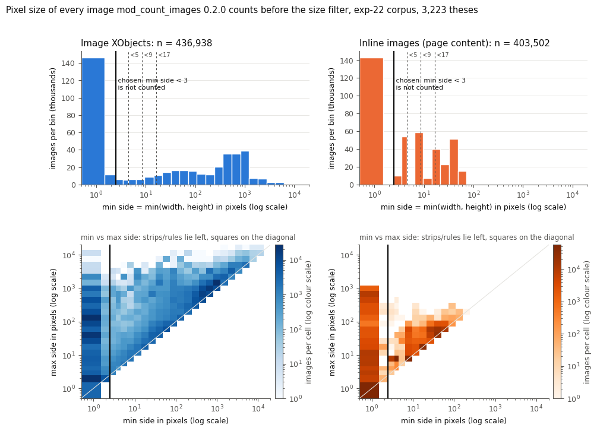

# ADR-0021: Image counting from the PDF structure, without decoding, with a minimum image size

**Status:** Accepted
**Date:** 2026-10-14
**Drivers:** #85 (count without decoding), #5 (performance tail), #52 (clean build, undeclared Pillow), [ADR-0011](0011-mvp-module-catalogue.md) (module catalogue; `mod_count_images` is the figure-module POC), [ADR-0015](0015-performance-budget.md) (2 s budget for `mod_count_images`), [SDD §7.1/§7.4](../SDD.md#71-overview). Separate from ADR-0011 because the rule, the data that grounds its threshold and the timing evidence would overload a catalogue ADR; ADR-0011 rev. 5 points here.

## Context

`mod_count_images` 0.1.0 computed `sum(len(page.images))` with pypdf. In pypdf 6.13.2 that parses each page's whole content stream with the pure-Python `ContentStream` tokenizer and **decodes every inline image** through Pillow, a package `pyproject.toml` never declared. Measured on the exp-22 corpus (3,233 theses, native Windows) and in #5:

- 104 theses errored with "pillow is required" in an environment without Pillow; 16 more errored with pypdf `LimitReachedError`, unsupported image modes or broken objects.
- On scanned and poster-like PDFs the module took 180-441 s under load; one 10-page 38 MB scan peaked at 0.94 GB in the worker.
- Nothing in the app uses decoded image data: `mod_count_images` was the only caller of `page.images`, and it only took `len()`.

Owner decision (2026-10-14): **images are only counted, never decoded.**

## Decision

`n_images` (module version **0.2.0**) is the sum over all pages of the number of images available to the page, read from the PDF structure with pypdf's object model.

1. **Nothing is decoded.** Image data, XObject or inline, is never decoded or even decompressed; Pillow is not a dependency. Only the page's own content streams are decompressed (their `/Filter`, e.g. Flate). `page.images` and pypdf's `_xobj_to_image` are not used.
2. **What counts, per page.**
   - Every **image XObject** (`/Subtype /Image`) reachable from the page's `/Resources /XObject`, recursing into **Form XObjects** and their resources at any depth. A per-page visited set of forms ends cycles.
   - Every **inline image** (`BI` ... `ID` ... `EI`) in the page's **own content stream(s)**, found by a byte-level scan that skips string literals, comments and image data. Inline images inside Form XObjects are not counted: Ghostscript-converted figures draw rules as 1x1 inline stencil masks inside forms, which turned one thesis from 0 into 5,686 "images".
   - Not counted: images reachable only through annotation appearance streams, patterns, Type 3 font glyphs or `/SMask` (as in 0.1.0). Counting is resource-based, not usage-based: an image listed in the reachable resources counts whether or not the content draws it (as in 0.1.0).
3. **Identity.** An image XObject is identified by its indirect reference. Per page it counts once, however often or under however many names it is reachable; across pages it counts once per page that reaches it. Each inline image counts once.
4. **Minimum size.** An image counts only if **both its pixel width and height are at least 3** (`MIN_IMAGE_SIDE_PX = 3`; `/Width`/`/Height` of the image dictionary, `/W`/`/H` or `/Width`/`/Height` of an inline image). An image whose size cannot be read as a positive integer does not count. The drawn size on the page plays no role: a 1x1 image stretched over a box is a fill or a rule, not a figure, and reading the drawn size would require interpreting the content stream's transformation matrices. The threshold is a constant in the module, not a setting. The data behind it is below.
5. **Errors are errors.** Missing or null `/Resources`, `/XObject` or `/Contents`, and entries that are not streams, contribute nothing. Errors pypdf raises while reading the file or decompressing a content stream (broken objects, encryption that cannot be opened, pypdf's 75 MB decompression limit) are not swallowed: the run ends as `error` with pypdf's message rather than a silently low count.

### Deviations from 0.1.0

1. pypdf re-added a page's inline images at every Form XObject it recursed into, so a page with *k* inline images and *f* forms counted *k*·(1+*f*). 0.2.0 counts *k*.
2. pypdf counted each resource *name*, so one image object under two names, or in both the page and a form, counted twice. 0.2.0 counts it once.
3. XObject entries whose `/Subtype` is neither `/Image` nor `/Form` are ignored; pypdf recursed into them as if they were forms.
4. Theses that errored because decoding failed now get a count.
5. Images smaller than 3 px on a side are not counted (rule 4).

## Grounding the minimum size

**Data.** The pixel size of every image counted by 0.2.0 *before* the size filter, read from the image dictionaries only (no decoding), over the exp-22 corpus (`TTA-exp22\B_fontfilter`, 3,233 theses, 3,223 read without error): 840,450 images, 436,948 image XObjects and 403,502 inline images. The collection scripts and raw tables are kept outside the repo (`exp-85\`).

*Figure: pixel size of every counted image, exp-22 corpus. Top: smaller side (min of width and height), log-spaced bins on a log x-axis, linear counts. Bottom: smaller vs larger side (log-log, log colour scale). Solid line: the chosen cut (min side < 3 px is not counted); dashed: candidate cuts.*

| min side (px) | image XObjects | % | inline images | % |
|---|---:|---:|---:|---:|
| 1 | 146,544 | 33.5 | 143,215 | 35.5 |
| 2 | 11,211 | 2.6 | 226 | 0.1 |
| 3-4 | 11,150 | 2.6 | 63,752 | 15.8 |
| 5-8 | 11,293 | 2.6 | 58,677 | 14.5 |
| 9-16 | 13,319 | 3.0 | 45,727 | 11.3 |
| 17-32 | 21,290 | 4.9 | 25,283 | 6.3 |
| 33-64 | 28,953 | 6.6 | 62,791 | 15.6 |
| 65-128 | 25,792 | 5.9 | 3,792 | 0.9 |
| 129-256 | 21,699 | 5.0 | 39 | 0.0 |
| 257-1024 | 119,598 | 27.4 | 0 | 0 |
| > 1024 | 26,089 | 6.0 | 0 | 0 |

(10 XObjects without a readable size, in one thesis, are not in the table.)

**Shape.** The image-XObject distribution is clearly **multimodal**: a spike at **1 px** (a third of all XObjects, 176 theses), a flat **valley from 3 to about 12 px** (about 5-6 thousand images per bin), a shoulder at **17-128 px** (icons, logos, legends) and the main mode at **300-1,300 px** (photos, screenshots and page scans). The min-vs-max panel shows what the 1 px spike is: images 1 px thin and up to thousands of px long, i.e. rules and strips. Inline images are a different population: they occur in only 83 theses, a 1 px spike (56,527 are 1x1, almost all stencil masks) plus discrete peaks at 4, 8, 16 and 33-64 px that come from a handful of theses whose producer drew text glyphs as inline bitmaps.

**Visual check.** For each bin (XObjects: 1, 2, 3-4, 5-8, 9-16, 17-32, 33-64 px; inline: 1, 3-4, 5-8, 9-16, 17-32, 33-64 px) twelve images from different theses were rendered as page crops with the image outlined (sheets kept outside the repo):

- **1 px:** table and header rules, underlines, separators, 1x1 masks stretched into lines, and single-pixel rows of logos and seals that the producer sliced into strips. No figure.
- **2 px:** dotted and double rules, table lines, 2-px strips of seals and screenshots. No figure.
- **3-4 px:** about a third rules and lines, two thirds strips of real images (photos, screenshots, a painting, a logo) cut into 3-4 px rows.
- **5-16 px:** mostly strips and fragments of real images, small icons, legend swatches, logo text lines.
- **17-64 px:** real small graphics: colour bars, legends, logos, small charts, text set as images.
- **Inline 33-64 px:** mostly glyphs of bitmap-font text (letters, equation pieces), plus some real logos.

**Choice: min side < 3 px is not counted.** The 1 px spike and its 2 px tail are the noise mode: in the sample they contained no figure. From 3 px on, real image content dominates; most of it is *fragments* (sliced strips), which the module counts per fragment by design (a documented POC limitation, see the help page), and a cut inside the valley (5, 9 or 17 px) would delete whole figures in theses whose producer slices images, while gaining little more noise reduction for XObjects. An area rule was considered and rejected: at equal noise removal (area < 64 removes 34.1 %, min side < 3 removes 35.8 %) it also removes small square icons and keeps long 1-px rules (a 1x200 rule has area 200).

| rule (not counted if ...) | XObjects dropped | inline dropped | share of all | theses changed |
|---|---:|---:|---:|---:|
| min side < 2 | 146,554 | 143,215 | 34.5 % | 259 |
| **min side < 3 (chosen)** | **157,765** | **143,441** | **35.8 %** | **298** |
| min side < 5 | 168,915 | 207,193 | 44.8 % | 346 |
| min side < 9 | 180,208 | 265,870 | 53.1 % | 420 |
| min side < 17 | 193,527 | 311,597 | 60.1 % | 514 |
| area < 64 | 104,150 | 182,441 | 34.1 % | 277 |
| area < 256 | 161,921 | 245,965 | 48.5 % | 358 |

(Theses changed counts all 3,233 theses, including 10 whose scan stopped at a pypdf error.)

**Effect of the chosen rule** on the 3,223 theses read without error: 2,930 unchanged, 293 changed (76 by at most 10 %, 65 by 10-50 %, 152 by 50 % or more), 5 drop to 0 (all their images were under 3 px). Median `n_images` per thesis 20 -> 19; mean 260 -> 167. The largest drops are rule-heavy documents, e.g. 25,119 -> 308 and 27,369 -> 4.

**Known limitation.** Glyph bitmaps (text set as inline image masks, 4-64 px) pass any threshold that keeps real logos; they inflate `n_images` in about a dozen theses. Filtering them would need the drawn context, which is out of scope for the POC (SDD §12, smarter figure module).

## Timing

Single process on native Windows (pds env), only `mod_count_images`. "Old (DB)": recorded durations of the exp-22 runs, which ran under multi-worker load. "Old (re-run)": the 0.1.0 expression re-run alone, without Pillow, with a timeout. 200-thesis sample = `TTA-exp22\A128_control`; #5 cases from the TTA-Theses database.

| | n | median | p90 | max |
|---|---:|---:|---:|---:|
| Old (DB), sample | 200 | 2,482 ms | 12,002 ms | 80,784 ms |
| Old (re-run), sample, ok runs | 192 | 810 ms | 2,822 ms | 12,870 ms |
| 0.2.0 before the size filter, sample | 200 | 66 ms | 182 ms | 1,735 ms |

| #5 case | pages | Old (DB) | Old (re-run) | 0.2.0 before the size filter |
|---|---:|---|---|---|
| 1330 | 10 | 166 s, n = 1,001 | timeout at 60 s | 0.36 s, n = 365 |
| 1421 | 133 | 18.4 s, n = 25,123 | 14.5 s | 2.97 s, n = 25,119 |
| 1784 | 170 | 8.6 s, n = 99 | 1.4 s | 0.50 s, n = 93 |
| 1303 | - | 205 s, `LimitReachedError` | timeout at 90 s | 0.6 s, `LimitReachedError` |

## Consequences

- ✅ No Pillow at run time; the "pillow is required" errors disappear, and the build can exclude Pillow ([ADR-0014](0014-distribution.md)).
- ✅ The tail falls from minutes to seconds; the sample stays well inside the 2 s budget of ADR-0015.
- ✅ The 1-2 px noise mode (35.8 % of all counted images) no longer counts.
- ⚠️ `n_images` values change against 0.1.0 (deviations above); results of the two versions must not be mixed.
- ⚠️ A content stream larger than pypdf's decompression limit (a page that is one huge inline scan) still ends as `error` (1303; 115 in the sample). Counting it would need a streaming decompress-and-scan.
- ⚠️ Pages with tens of thousands of image XObjects remain the slowest case (2.97 s for 1421), dominated by pypdf object loading, not by decoding.
- ⚠️ Fragments (sliced images) and glyph bitmaps still inflate counts; that is the POC's documented limitation.

## Revisit when

- The smarter figure module (SDD §12) replaces the POC.
- A pypdf upgrade changes object loading or its decompression limits.
- A corpus shows a different size distribution (e.g. a producer that slices images into 1-2 px strips at scale).
